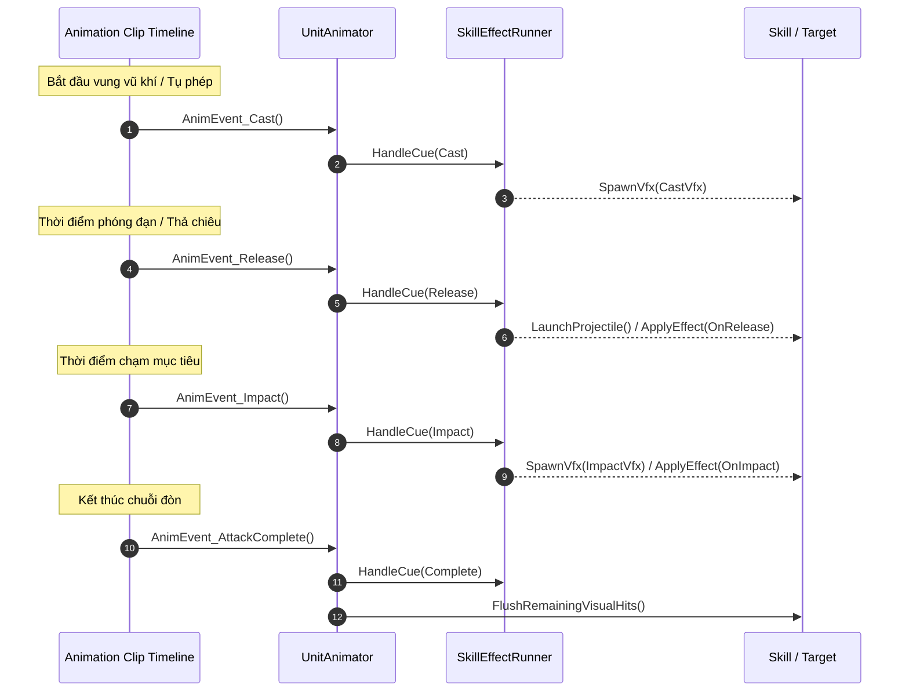

# Workflow Cấu Hình Animation Events Khớp Với VFX Cues Cho Unit (UCP tích hợp)

Tài liệu quy định quy trình chuẩn để thiết lập Animation Events trên các Animation Clip tấn công/kỹ năng, đồng bộ thời điểm phát VFX, phóng projectile và tính sát thương với hệ thống [`UnitAnimator`](file:///e:/UnityProject/My%20Turnbased/turnbased_2025/Assets/Scripts/Unit/UnitAnimator.cs) và [`SkillEffectRunner`](file:///e:/UnityProject/My%20Turnbased/turnbased_2025/Assets/Scripts/Unit/SkillEffectRunner.cs), đồng thời xác thực không lỗi qua Unity Control Protocol (`ucp` CLI).

Quy trình này áp dụng sau khi đã hoàn tất cấu hình Animator, Avatar và gắn vũ khí theo [Character_Animator_Avatar_Setup_Workflow.md](file:///e:/UnityProject/My%20Turnbased/turnbased_2025/Assets/Docs/Workflow/Character_Animator_Avatar_Setup_Workflow.md) và [Character_Weapon_Shield_Setup_Workflow.md](file:///e:/UnityProject/My%20Turnbased/turnbased_2025/Assets/Docs/Workflow/Character_Weapon_Shield_Setup_Workflow.md).

> [!IMPORTANT]
> **YÊU CẦU BẮT BUỘC SỬ DỤNG UNITY CONTROL PROTOCOL (UCP)**:
> Sau khi gắn hoặc sửa đổi Animation Events trên các clip, bắt buộc phải dùng UCP CLI để kiểm tra compile và quét sạch toàn bộ lỗi `AnimationEvent '...' has no receiver!` từ Unity Console logs trước khi nghiệm thu.

---

## 1. Cơ Chế Hoạt Động & Chuỗi Sự Kiện

Hệ thống kỹ năng dựa trên các phương thức công khai của [`UnitAnimator`](file:///e:/UnityProject/My%20Turnbased/turnbased_2025/Assets/Scripts/Unit/UnitAnimator.cs) để bắt các mốc thời gian trên timeline animation và chuyển tiếp tới [`SkillEffectRunner`](file:///e:/UnityProject/My%20Turnbased/turnbased_2025/Assets/Scripts/Unit/SkillEffectRunner.cs):



---

## 2. Danh Sách Các Animation Events Chuẩn

Các hàm sau đây được khai báo công khai trong [`UnitAnimator.cs`](file:///e:/UnityProject/My%20Turnbased/turnbased_2025/Assets/Scripts/Unit/UnitAnimator.cs#L99-L162) và phải được chọn chính xác từng ký tự trong Animation Event Inspector:

1. **`AnimEvent_Cast`**:
   - **Thời điểm**: Ngay khi nhân vật bắt đầu tụ phép hoặc chuẩn bị vung đòn.
   - **Tác vụ**: Kích hoạt `CastVfxPrefab` tại vị trí cast (thường là ngực hoặc dưới chân caster).
   - **Áp dụng**: Các kỹ năng có thời gian tụ hoặc niệm ấn (ví dụ: `Accusation`, `Forbidden Seal`, `Purification`).

2. **`AnimEvent_Release`**:
   - **Thời điểm**: Khung hình cung thủ buông dây cung, pháp sư bắn tia phép từ đầu gậy, hoặc kiếm sĩ vung ra luồng khí kiếm.
   - **Tác vụ**: Sinh projectile và bay về mục tiêu; kích hoạt hiệu ứng áp dụng nếu kỹ năng cấu hình `SkillEffectApplyTiming.OnRelease`.
   - **Bắt buộc cho**: `Normal Arrow`, `Multi Strike Arrow`, `Fire Seal`, `Quick Slash`...

3. **`AnimEvent_Impact`**:
   - **Thời điểm**: Khung hình vũ khí melee chạm trúng người nạn nhân, hoặc phép diện rộng nổ tung.
   - **Tác vụ**: Sinh `ImpactVfxPrefab`, rung lắc, trừ máu/hiển thị số sát thương và kích hoạt hiệu ứng debuff/knockback.
   - **Bắt buộc cho**: Tất cả đòn đánh cận chiến (`Slash attack`, `Blood Hammer`, `Earthquake`, `Holy Sword Stance`, `Power Strike`...).

4. **`AnimEvent_AttackComplete`**:
   - **Thời điểm**: Khung hình cuối cùng của animation tấn công khi nhân vật bắt đầu thu thế về Idle.
   - **Tác vụ**: Hủy safety timer, dọn dẹp các visual hit còn sót (`FlushRemainingVisualHits()`) và trả trạng thái lượt cho [`UnitController`](file:///e:/UnityProject/My%20Turnbased/turnbased_2025/Assets/Scripts/Unit/UnitController.cs).
   - **Bắt buộc cho**: Mọi animation tấn công.
   > [!IMPORTANT]
   > Nếu animation thiếu `AnimEvent_AttackComplete`, lượt chơi sẽ bị kẹt hoặc phải chờ hết thời gian safety timer timeout (gây khựng nhịp trận đấu).

5. **`AnimEvent_SkillCue(string cue)` (Event tham số String)**:
   - Dùng khi cần gọi linh hoạt qua tham số chuỗi: nhập một trong các giá trị `Cast`, `Release`, `Impact` hoặc `Complete`.

---

## 3. Quy Tắc Gắn Event Lên Animation Clip

### 3.1. Các Thao Tác Trong Unity Editor
1. Mở cửa sổ **Animation** (`Window > Animation > Animation`).
2. Trong Hierarchy, chọn GameObject `Body` của nhân vật (nơi chứa component [`UnitAnimator`](file:///e:/UnityProject/My%20Turnbased/turnbased_2025/Assets/Scripts/Unit/UnitAnimator.cs)).
3. Chọn animation clip cần gán event trong danh sách dropdown.
4. Di chuyển con trỏ thời gian (Scrubber) đến đúng frame mong muốn.
5. Nhấn nút **Add Event** (biểu tượng vạch kẻ có dấu cộng nhỏ dưới thước đo timeline).
6. Trong cửa sổ **Inspector**, chọn hàm tương ứng từ danh sách dropdown function của [`UnitAnimator`](file:///e:/UnityProject/My%20Turnbased/turnbased_2025/Assets/Scripts/Unit/UnitAnimator.cs).

### 3.2. Cấu Trúc Event Chuẩn Cho Từng Loại Đòn Đánh
- **Đòn cận chiến Melee**: Gắn `AnimEvent_Impact` tại frame chém chạm đích; gắn `AnimEvent_AttackComplete` ở gần cuối clip.
- **Đòn bắn xa Ranged / Projectile**: Gắn `AnimEvent_Release` tại frame đạn/tên rời tay; gắn `AnimEvent_AttackComplete` ở cuối clip.
- **Kỹ năng đa đoạn Multi-hit**: Gắn một `AnimEvent_Impact` tại mỗi lần vung trúng đích; gắn `AnimEvent_AttackComplete` sau nhát chém cuối cùng.
- **Kỹ năng tụ lực/niệm ấn**: Gắn `AnimEvent_Cast` ở frame bắt đầu niệm; gắn `AnimEvent_Release` hoặc `AnimEvent_Impact` ở frame phát chiêu; gắn `AnimEvent_AttackComplete` ở cuối clip.

---

## 4. Xác Thực & Kiểm Tra Tự Động Bằng UCP CLI

Sau khi gán các Animation Events vào Clip, chạy chuỗi lệnh UCP sau để kiểm tra:

### 4.1. Chạy Sample Animation Kiểm Tra Clip Bằng UCP
```powershell
ucp --bridge-update-policy off exec run character-builder --parameters '{
  "action": "check-animation",
  "className": "<ClassName>"
}' --json
```

### 4.2. Quét Console Bằng UCP Để Bắt Lỗi Thiếu Receiver
Chạy lệnh kiểm tra console logs để đảm bảo Unity không cảnh báo thiếu hàm nhận:
```powershell
ucp --bridge-update-policy off console logs --types error,warning --json
```
Nếu xuất hiện log chứa `AnimationEvent ... has no receiver!`:
- Kiểm tra xem component [`UnitAnimator`](file:///e:/UnityProject/My%20Turnbased/turnbased_2025/Assets/Scripts/Unit/UnitAnimator.cs) đã nằm đúng trên GameObject `Body` (cùng node với `Animator`) hay chưa.
- Kiểm tra lại tên method được gán trong Animation Event Inspector xem có bị sai chính tả không.

---

## 5. Checklist Kiểm Tra & Nghiệm Thu Qua UCP

- [ ] Lệnh `ucp console logs` không chứa bất kỳ cảnh báo `has no receiver!`.
- [ ] Tất cả Animation Clip tấn công đều có tối thiểu một event kích hoạt sát thương (`AnimEvent_Impact` hoặc `AnimEvent_Release`).
- [ ] Tất cả Animation Clip tấn công đều có event kết thúc `AnimEvent_AttackComplete`.
- [ ] Lệnh `character-builder` với action `check-animation` chạy mượt mà, không gặp exception.
- [ ] Chụp màn hình Play Mode kiểm tra đòn đánh: số sát thương hiển thị đúng khoảnh khắc vũ khí tiếp xúc mục tiêu.
