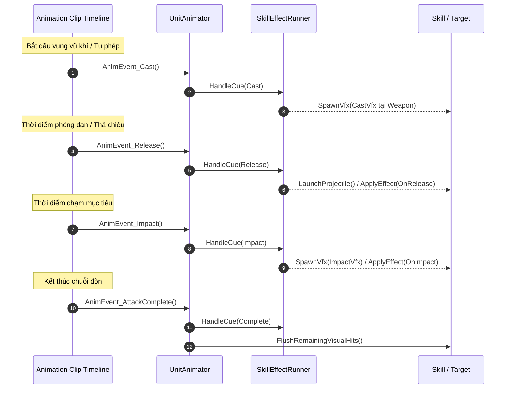

# Workflow Giai Đoạn 3: Cấu Hình Animation Events Khớp Với VFX Cues Cho Unit (UCP tích hợp)

Tài liệu quy định quy trình chuẩn để thiết lập Animation Events trên các Animation Clip tấn công/kỹ năng, đồng bộ thời điểm phát VFX (tại `_effectSpawnPoint` trên vũ khí), phóng projectile và tính sát thương với hệ thống [`UnitAnimator`](file:///e:/UnityProject/My%20Turnbased/turnbased_2025/Assets/Scripts/Unit/UnitAnimator.cs) và [`SkillEffectRunner`](file:///e:/UnityProject/My%20Turnbased/turnbased_2025/Assets/Scripts/Unit/SkillEffectRunner.cs), đồng thời nghiệm thu không lỗi qua Unity Control Protocol (`ucp` CLI).

Quy trình này áp dụng sau khi đã hoàn tất cấu hình Animator, Avatar và gắn vũ khí theo [Character_Animator_Avatar_Setup_Workflow.md](file:///e:/UnityProject/My%20Turnbased/turnbased_2025/Assets/Docs/Workflow/Character_Animator_Avatar_Setup_Workflow.md).

> [!IMPORTANT]
> **QUY TẮC NGHIỆM THU BẰNG UNITY CONTROL PROTOCOL (UCP)**:
> Việc gắn Animation Events có thể thực hiện tự động qua action `setup-animation-events` của `character-builder` hoặc chỉnh sửa trên Animation Window/ModelImporter, nhưng **bắt buộc phải nghiệm thu bằng UCP CLI** (`check-animation` và `console logs`) để đảm bảo không có cảnh báo `AnimationEvent '...' has no receiver!`.

---

## 1. Cơ Chế Hoạt Động & Chuỗi Sự Kiện

Hệ thống kỹ năng dựa trên các phương thức công khai của [`UnitAnimator`](file:///e:/UnityProject/My%20Turnbased/turnbased_2025/Assets/Scripts/Unit/UnitAnimator.cs) để bắt các mốc thời gian trên timeline animation và chuyển tiếp tới [`SkillEffectRunner`](file:///e:/UnityProject/My%20Turnbased/turnbased_2025/Assets/Scripts/Unit/SkillEffectRunner.cs) (sử dụng `_effectSpawnPoint` đã trỏ vào Transform của vũ khí):



---

## 2. Danh Sách Đầy Đủ Các Animation Events Trong `UnitAnimator`

Các phương thức sau được khai báo công khai trong [`UnitAnimator.cs`](file:///e:/UnityProject/My%20Turnbased/turnbased_2025/Assets/Scripts/Unit/UnitAnimator.cs#L99-L162) và phải khớp chính xác từng ký tự:

### 2.1. Nhóm Events Chuẩn (Khuyên dùng cho mọi Clip mới)
1. **`AnimEvent_Cast`**:
   - **Thời điểm**: Ngay khi nhân vật bắt đầu tụ phép hoặc chuẩn bị vung đòn.
   - **Tác vụ**: Kích hoạt `SkillAnimationCue.Cast` (`CastVfxPrefab` tại vị trí vũ khí/caster).
2. **`AnimEvent_Release`**:
   - **Thời điểm**: Khung hình cung thủ buông dây cung, pháp sư bắn tia phép từ đầu vũ khí, hoặc kiếm sĩ phóng luồng khí kiếm.
   - **Tác vụ**: Kích hoạt `SkillAnimationCue.Release` (sinh projectile từ `_effectSpawnPoint` trên vũ khí; áp dụng hiệu ứng nếu kỹ năng cấu hình `SkillEffectApplyTiming.OnRelease`).
3. **`AnimEvent_Impact`**:
   - **Thời điểm**: Khung hình vũ khí melee chạm trúng mục tiêu, hoặc phép diện rộng phát nổ.
   - **Tác vụ**: Kích hoạt `SkillAnimationCue.Impact` (`ImpactVfxPrefab`, trừ máu, hiển thị sát thương, debuff/knockback).
4. **`AnimEvent_AttackComplete`**:
   - **Thời điểm**: Khung hình cuối của animation tấn công (thường ở `0.95` normalized time) khi nhân vật thu thế về Idle.
   - **Tác vụ**: Kích hoạt `SkillAnimationCue.Complete`, hủy safety timer (`2.5s`), gọi `FlushRemainingVisualHits()` và trả trạng thái lượt.
   > [!IMPORTANT]
   > Mọi animation tấn công bắt buộc phải có `AnimEvent_AttackComplete`. Nếu thiếu, lượt đấu sẽ bị trễ do phải đợi hết `2.5s` của `SafetyFlushTimer`.
5. **`AnimEvent_SkillCue(string cueName)`**:
   - Event có tham số `string`, parse không phân biệt hoa thường sang enum `SkillAnimationCue` (`Cast`, `Release`, `Impact`, `Complete`).

### 2.2. Nhóm Events Mở Rộng & Tương Thích Ngược (Legacy)
6. **`AnimEvent_DeathComplete`**:
   - Phát sự kiện `AnimationEventRaised("DeathComplete")` ở cuối clip `Death`.
7. **`AnimEvent_AttackHit`** *(Legacy)*: Tự động chuyển tiếp sang `AnimEvent_Impact()`.
8. **`AnimEvent_AttackStart`** *(Legacy)*: Tự động chuyển tiếp sang `AnimEvent_Release()`.
9. **`AnimEvent_StartEffect`** *(Legacy)*: Tự động chuyển tiếp sang `AnimEvent_Impact()`.

---

## 3. Hai Phương Thức Thiết Lập Animation Events

### 3.1. Phương Thức Tự Động Bằng UCP (`setup-animation-events`)
Script [`CharacterBuilder.cs`](file:///e:/UnityProject/My%20Turnbased/turnbased_2025/Assets/Scripts/Editor/CharacterBuilder.cs#L1075-L1214) cung cấp action `setup-animation-events` để cấu hình hàng loạt trên các file `.fbx` thuộc `AnimatorController` của Unit:
- Tự động gắn `AnimEvent_Impact` (tại mốc event cũ hoặc mặc định `0.5`) và `AnimEvent_AttackComplete` (tại `0.95`) cho các clip có tên chứa `"Attack"` hoặc `"Hammer"`.
- Tự động xóa các event bước chân (`FootR`, `FootL`) trên các clip có tên chứa `"Run"` để tránh cảnh báo `has no receiver!`.
- Tự động kiểm tra và liên kết `UnitAnimator._effectSpawnPoint` vào Transform của vũ khí nếu đang bị trống.

```powershell
ucp --bridge-update-policy off exec run character-builder --parameters '{
  "action": "setup-animation-events",
  "className": "<ClassName>"
}' --json
```

> [!WARNING]
> Action `setup-animation-events` sẽ **ghi đè toàn bộ mảng `events`** trên `ModelImporter` của các clip chứa `"Attack"`, `"Hammer"` và `"Run"`. Không chạy lệnh này trên các clip đã được căn chỉnh nhiều event phức tạp (`Cast` + `Release` + multi-hit `Impact`) bằng tay.

### 3.2. Phương Thức Căn Chỉnh Thủ Công Cho Clip Đặc Thù (Multi-hit / Ranged / Cast)
Với các kỹ năng cần nhiều mốc event chính xác trên từng frame:
1. Mở cửa sổ **Animation** (`Window > Animation > Animation`) hoặc tab **Animation > Events** trong `ModelImporter` của file `.fbx`.
2. Gắn event theo loại đòn đánh:
   - **Đòn cận chiến Melee**: `AnimEvent_Impact` tại frame vũ khí chạm đích + `AnimEvent_AttackComplete` ở cuối clip.
   - **Đòn bắn xa Ranged / Projectile**: `AnimEvent_Release` tại frame đạn rời vũ khí + `AnimEvent_AttackComplete` ở cuối clip.
   - **Kỹ năng đa đoạn Multi-hit**: Nhiều `AnimEvent_Impact` tại mỗi nhát chém + `AnimEvent_AttackComplete` sau nhát cuối.
   - **Kỹ năng tụ lực / niệm ấn**: `AnimEvent_Cast` ở đầu clip + `AnimEvent_Release`/`AnimEvent_Impact` khi phát chiêu + `AnimEvent_AttackComplete` ở cuối clip.

---

## 4. Xác Thực & Nghiệm Thu Bằng UCP CLI

### 4.1. Chạy Sample Animation & Chụp Ảnh Kiểm Tra Vũ Khí (`check-animation`)
```powershell
ucp --bridge-update-policy off exec run character-builder --parameters '{
  "action": "check-animation",
  "className": "<ClassName>"
}' --json
```

### 4.2. Quét Console Bằng UCP Để Bắt Lỗi Thiếu Receiver
```powershell
ucp --bridge-update-policy off console logs --types error,warning --json
```
Nếu xuất hiện log chứa `AnimationEvent ... has no receiver!`:
- Kiểm tra component [`UnitAnimator`](file:///e:/UnityProject/My%20Turnbased/turnbased_2025/Assets/Scripts/Unit/UnitAnimator.cs) đã nằm cùng GameObject `Body` với `Animator` hay chưa.
- Nếu lỗi báo cho `FootL` / `FootR` trên clip chạy, chạy action `setup-animation-events` hoặc xóa event bước chân khỏi clip `Run`.

---

## 5. Checklist Kiểm Tra & Nghiệm Thu Qua UCP

- [ ] Lệnh `ucp --bridge-update-policy off console logs --types error,warning --json` không chứa bất kỳ cảnh báo `has no receiver!`.
- [ ] Tất cả Animation Clip tấn công đều có tối thiểu một event kích hoạt hiệu ứng (`AnimEvent_Impact` hoặc `AnimEvent_Release`).
- [ ] Tất cả Animation Clip tấn công đều có event kết thúc `AnimEvent_AttackComplete`.
- [ ] `UnitAnimator._effectSpawnPoint` đã trỏ vào Transform của vũ khí.
- [ ] Lệnh `character-builder` với action `check-animation` trả về `"success": true` và xuất đầy đủ ảnh preview trong `Artifacts/`.

---

## 6. Liên Kết Quy Trình
- Quay lại [Master Workflow: Character_Animation_Weapon_Setup_Workflow.md](file:///e:/UnityProject/My%20Turnbased/turnbased_2025/Assets/Docs/Workflow/Character_Animation_Weapon_Setup_Workflow.md) để chạy bước `validate` nghiệm thu toàn trình.
