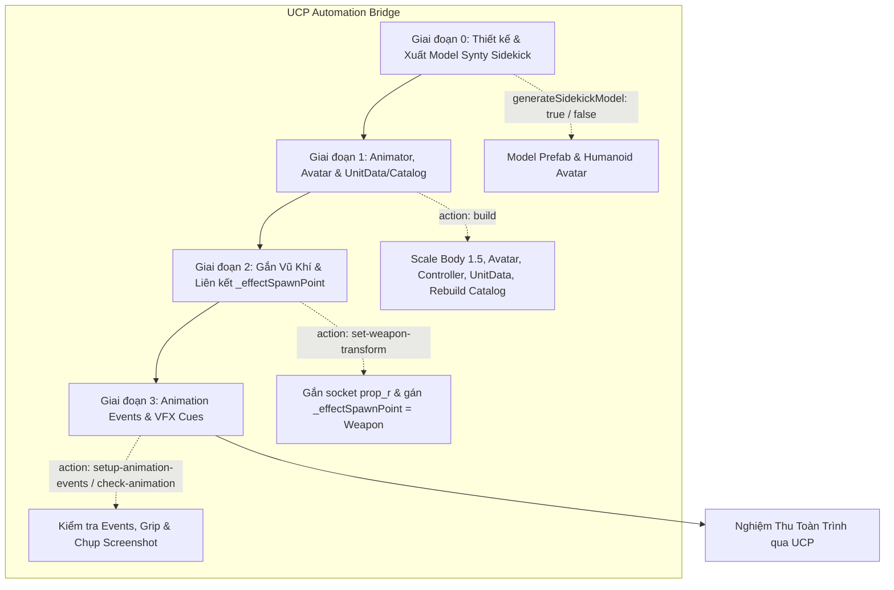

# Master Workflow: Tạo & Tích Hợp Character Toàn Trình (UCP tích hợp)

Tài liệu quy định quy trình tổng thể (Master Workflow) kết nối chuỗi các giai đoạn nhằm thiết kế Model Synty Sidekick, thiết lập Animator/Avatar Humanoid, gắn vũ khí vào socket khung xương (kèm liên kết `_effectSpawnPoint`), cấu hình Animation Events đồng bộ với hệ thống kỹ năng/VFX ([`SkillEffectRunner`](file:///e:/UnityProject/My%20Turnbased/turnbased_2025/Assets/Scripts/Unit/SkillEffectRunner.cs) và [`UnitAnimator`](file:///e:/UnityProject/My%20Turnbased/turnbased_2025/Assets/Scripts/Unit/UnitAnimator.cs)) và tích hợp `UnitData` / `MatchContentCatalog`.

> [!IMPORTANT]
> **QUY TẮC SỬ DỤNG UNITY CONTROL PROTOCOL (UCP)**:
> Mọi thao tác dựng prefab, cấu hình tham chiếu, căn chỉnh vũ khí và nghiệm thu tính hợp lệ đều thực hiện qua Unity Control Protocol (`ucp` CLI, https://unityctl.dev) kết nối với script [`CharacterBuilder.cs`](file:///e:/UnityProject/My%20Turnbased/turnbased_2025/Assets/Scripts/Editor/CharacterBuilder.cs) (`IUCPScript`).
> Luôn sử dụng flag `--bridge-update-policy off` và `--parameters` trong mọi câu lệnh UCP CLI.

---

## 1. Kiến Trúc & Chuỗi Workflow Tuần Tự



Quy trình chi tiết theo từng giai đoạn: (Qua mỗi giai đoạn đều phải xác nhận trước khi đi tới giai đoạn tiếp theo)

1. **[Giai đoạn 0: Thiết kế & Tạo Model Synty Sidekick](file:///e:/UnityProject/My%20Turnbased/turnbased_2025/Assets/Docs/Workflow/Synty_Sidekick_Character_Creation_Workflow.md)**
   - Bảng định hướng visual, body sliders, parts, bảng màu và danh sách prefab vũ khí chuẩn của 10 class.
   - Tạo model tự động (`generateSidekickModel: true`) hoặc nạp từ Model Prefab có sẵn (`Assets/MyGame/Prefabs/Model/<ClassName>_M/<ClassName>.prefab`).

2. **[Giai đoạn 1: Cấu hình Animator & Avatar Humanoid](file:///e:/UnityProject/My%20Turnbased/turnbased_2025/Assets/Docs/Workflow/Character_Animator_Avatar_Setup_Workflow.md)**
   - Cấu hình GameObject con `Body` (`Scale = 1.5, 1.5, 1.5`).
   - Cấu hình `Animator` (Humanoid Avatar, Controller do người dùng tạo/chỉ định, tắt Apply Root Motion).
   - Thiết lập [`UnitAnimator`](file:///e:/UnityProject/My%20Turnbased/turnbased_2025/Assets/Scripts/Unit/UnitAnimator.cs) với `_effectSpawnPoint` trỏ trực tiếp vào Transform của vũ khí.

3. **Giai đoạn 2: Gắn Vũ Khí & Căn Chỉnh Transform (`set-weapon-transform`)**
   - Gắn prefab vũ khí từ `Assets/MyGame/Resource/Unit/Weapons/` vào socket xương bàn tay (thứ tự fallback trong code: `weaponBoneName` -> `prop_r` -> `hand_r` -> `ring_01_r`).
   - Tự động gán `UnitAnimator._effectSpawnPoint` trỏ vào Transform của vũ khí.

4. **[Giai đoạn 3: Cấu hình Animation Events Khớp Với VFX Cues](file:///e:/UnityProject/My%20Turnbased/turnbased_2025/Assets/Docs/Workflow/Character_Animation_Events_VFX_Setup_Workflow.md)**
   - Cấu hình đầy đủ hệ thống Animation Events trên [`UnitAnimator`](file:///e:/UnityProject/My%20Turnbased/turnbased_2025/Assets/Scripts/Unit/UnitAnimator.cs) (bao gồm 5 event chuẩn và 4 event mở rộng/legacy).
   - Quét Console tìm lỗi thiếu receiver và chạy `check-animation` để chụp ảnh kiểm chứng tay cầm vũ khí.

---

## 2. Bảng Tham Số Cấu Hình Đầy Đủ (`BuildParams` trong `CharacterBuilder.cs`)

| Nhóm | Tham số | Kiểu dữ liệu | Mặc định | Mô tả |
|---|---|---|---|---|
| **Hành động** | `action` | `string` | `"build"` | `"build"`, `"validate"`, `"set-weapon-transform"`, `"check-animation"`, `"setup-animation-events"` |
| | `className` | `string` | *(Bắt buộc)* | Tên class (ví dụ: `Berserker`, `Adjudicator`, `Herbalist`) |
| | `outputPrefabPath` | `string` | `Assets/MyGame/Resource/Unit/<className>.prefab` | Đường dẫn lưu Unit Prefab hoàn chỉnh |
| | `baseUnitPrefabPath` | `string` | `Assets/MyGame/Resource/Unit/Knight.prefab` | Template prefab chuẩn chứa `Body`, `UnitController`, `UnitAnimator` |
| **Synty Sidekick** | `generateSidekickModel` | `bool` | `false` | `true`: tự động query DB, combine mesh, bake texture và tạo Humanoid Avatar |
| | `bodyTypeBlend` | `float` | `-10` | Hình thể (-100 đến +100) |
| | `bodySizeBlend` | `float` | `15` | Độ to béo / gầy |
| | `musclesBlend` | `float` | `15` | Độ cơ bắp |
| | `partNames` | `string[]` | *Bộ Adjudicator* | Danh sách tên mesh part (`SidekickPart`) ghép vào nhân vật |
| | `palette` / mã màu | `ColorPaletteParams` / `string` | *(Mặc định)* | Bảng màu nhân vật (`skinColor`, `hairColor`, `eyeColor`, `primaryColor`, `secondaryColor`, `trimColor`, `metalColor`, `jewelColor`) |
| | `colorOverrides` | `ColorOverride[]` | `null` | Ghi đè màu trực tiếp theo từ khóa thuộc tính |
| | `modelPrefabPath` | `string` | `Assets/MyGame/Prefabs/Model/<className>_M/<className>.prefab` | Đường dẫn Model Prefab |
| **Vũ khí & SpawnPoint** | `weaponPrefabPath` | `string` | `""` | Đường dẫn prefab vũ khí trong `Assets/MyGame/Resource/Unit/Weapons/` |
| | `weaponBoneName` | `string` | `"prop_r"` | Tên bone gắn vũ khí (tự động fallback `prop_r` -> `hand_r` -> `ring_01_r`) |
| | `weaponLocalPos` | `Vector3` | `(0.033, 0.016, 0.002)` | Vị trí offset local (riêng `Adjudicator`/`Herbalist` mặc định `(-0.014, -0.15, -0.033)`) |
| | `weaponLocalEuler` | `Vector3` | `(-2.5, -94, 88)` | Góc xoay offset local (riêng `Adjudicator`/`Herbalist` mặc định `(180, 0, 0)`) |
| | `weaponLocalScale` | `Vector3` | `(1, 1, 1)` | Tỉ lệ phóng to/thu nhỏ vũ khí |
| **Gameplay Data** | `unitDataPath` | `string` | `""` | Đường dẫn ScriptableObject `UnitData` (ví dụ: `Assets/Scripts/Data/<ClassName> Data.asset`) |
| | `skillPaths` | `string[]` | `[]` | Danh sách asset `SkillBase` nạp vào `StartingSkills` của `UnitData` |
| | `animatorControllerPath` | `string` | `""` | Đường dẫn `RuntimeAnimatorController` hoặc `AnimatorOverrideController` do người dùng tạo |

> [!NOTE]
> Khi thực thi `action: "build"`, script sẽ tự động gán `UnitAnimator._effectSpawnPoint` vào Transform của vũ khí (chỉ fallback về node `EffectSpawnPoint` hoặc `Body` nếu nhân vật không gắn vũ khí) và tự động gọi `MatchContentCatalogBuilder.Rebuild()`.

---

## 3. Lệnh UCP Điều Khiển Theo Từng Bước

### 3.1. Kiểm Tra Trạng Thái Editor & Compile
```powershell
# 1. Kích hoạt biên dịch lại code Editor nếu có thay đổi
ucp --bridge-update-policy off compile --json

# 2. Kiểm tra Console log để phát hiện lỗi biên dịch hoặc thiếu script
ucp --bridge-update-policy off console logs --types error,warning --json
```

### 3.2. Căn Chỉnh Lại Vũ Khí & Liên Kết `_effectSpawnPoint` (`set-weapon-transform`)
```powershell
ucp --bridge-update-policy off exec run character-builder --parameters '{
  "action": "set-weapon-transform",
  "className": "<ClassName>",
  "weaponBoneName": "prop_r",
  "weaponLocalPos": {"x": 0.033, "y": 0.016, "z": 0.002},
  "weaponLocalEuler": {"x": -2.5, "y": -94.0, "z": 88.0},
  "weaponLocalScale": {"x": 1.0, "y": 1.0, "z": 1.0}
}' --json
```

### 3.3. Kiểm Tra Tính Hợp Lệ Của Prefab (`validate`)
```powershell
ucp --bridge-update-policy off exec run character-builder --parameters '{
  "action": "validate",
  "className": "<ClassName>"
}' --json
```

### 3.4. Kiểm Tra Animation, Độ Khớp Tay Cầm & Chụp Ảnh Preview (`check-animation`)
Lệnh này tự động tạo instance tạm, sample qua các clip trong Controller, đo khoảng cách từ xương bàn tay đến trục vũ khí (`radialDistanceToStaff`, `alongStaffOffset`), chụp ảnh preview đa góc vào `Artifacts/` và tự hủy instance tạm mà không làm bẩn (dirty) scene đang mở:
```powershell
ucp --bridge-update-policy off exec run character-builder --parameters '{
  "action": "check-animation",
  "className": "<ClassName>"
}' --json
```

---

## 4. Checklist Nghiệm Thu Toàn Trình Qua UCP

- [ ] Hoàn thành thiết kế/xuất model theo [Synty_Sidekick_Character_Creation_Workflow.md](file:///e:/UnityProject/My%20Turnbased/turnbased_2025/Assets/Docs/Workflow/Synty_Sidekick_Character_Creation_Workflow.md).
- [ ] Hoàn thành cấu hình và nghiệm thu theo [Character_Animator_Avatar_Setup_Workflow.md](file:///e:/UnityProject/My%20Turnbased/turnbased_2025/Assets/Docs/Workflow/Character_Animator_Avatar_Setup_Workflow.md).
- [ ] Vũ khí nằm đúng dưới bone bàn tay (`prop_r` / `hand_r`), `UnitAnimator._effectSpawnPoint` trỏ đúng vào Transform của vũ khí.
- [ ] Hoàn thành cấu hình và nghiệm thu theo [Character_Animation_Events_VFX_Setup_Workflow.md](file:///e:/UnityProject/My%20Turnbased/turnbased_2025/Assets/Docs/Workflow/Character_Animation_Events_VFX_Setup_Workflow.md).
- [ ] Chạy lệnh `validate` của `character-builder` trả về `"valid": true`, mảng `"errors"` rỗng.
- [ ] Lệnh `ucp --bridge-update-policy off console logs --types error,warning --json` không chứa lỗi `AnimationEvent '...' has no receiver!` hoặc `MissingReferenceException`.
