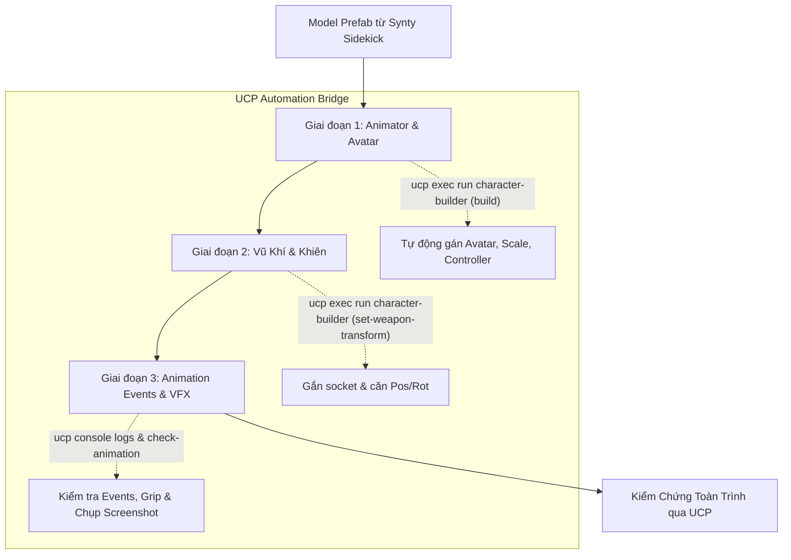

# Master Workflow: Cấu Hình Animation, Vũ Khí & Event Cues Cho Unit (UCP tích hợp)

Tài liệu quy định quy trình tổng thể (Master Workflow) kết nối chuỗi 3 giai đoạn độc lập nhằm thiết lập Animator, Avatar Humanoid, gắn vũ khí/khiên vào socket khung xương và cấu hình Animation Events đồng bộ với hệ thống kỹ năng/VFX ([`SkillEffectRunner`](file:///e:/UnityProject/My%20Turnbased/turnbased_2025/Assets/Scripts/Unit/SkillEffectRunner.cs) và [`UnitAnimator`](file:///e:/UnityProject/My%20Turnbased/turnbased_2025/Assets/Scripts/Unit/UnitAnimator.cs)).

Quy trình này áp dụng sau khi hoàn tất xuất Model Prefab từ [Synty_Sidekick_Character_Creation_Workflow.md](file:///e:/UnityProject/My%20Turnbased/turnbased_2025/Assets/Docs/Workflow/Synty_Sidekick_Character_Creation_Workflow.md).

> [!IMPORTANT]
> **YÊU CẦU BẮT BUỘC SỬ DỤNG UNITY CONTROL PROTOCOL (UCP)**:
> Mọi thao tác dựng prefab, cấu hình tham chiếu, căn chỉnh vũ khí và kiểm tra tính hợp lệ phải được thực hiện hoặc xác thực qua Unity Control Protocol (`ucp` CLI, https://unityctl.dev) kết nối với Unity Editor Bridge (`0.6.4+`).
> Luôn sử dụng flag `--bridge-update-policy off` trong mọi câu lệnh UCP để tránh tự động cập nhật package.

---

## 1. Chuỗi Workflow Tuần Tự & Các Lệnh UCP



Quy trình được chia thành 3 workflow chi tiết độc lập:

1. **[Giai đoạn 1: Cấu hình Animator & Avatar Humanoid](file:///e:/UnityProject/My%20Turnbased/turnbased_2025/Assets/Docs/Workflow/Character_Animator_Avatar_Setup_Workflow.md)**
   - Cấu hình GameObject con `Body` (`Scale = 1.5, 1.5, 1.5`).
   - Cấu hình `Animator` (Humanoid Avatar, Controller class, tắt Apply Root Motion).
   - Thiết lập [`UnitAnimator`](file:///e:/UnityProject/My%20Turnbased/turnbased_2025/Assets/Scripts/Unit/UnitAnimator.cs) và node `EffectSpawnPoint`.
   - **Lệnh UCP**: `ucp --bridge-update-policy off exec run character-builder --parameters '{"action":"build", "className":"<ClassName>", ...}' --json`.

2. **[Giai đoạn 2: Gắn Vũ Khí & Khiên (Weapon & Shield Sockets)](file:///e:/UnityProject/My%20Turnbased/turnbased_2025/Assets/Docs/Workflow/Character_Weapon_Shield_Setup_Workflow.md)**
   - Socket khung xương tay phải (`Item_Hand_R` / `prop_r` / `hand_r`) và tay trái (`Item_Hand_L`).
   - Prefab vũ khí/khiên chuẩn theo class tại `Assets/MyGame/Resource/Unit/Weapons/`.
   - Căn chỉnh Transform và kiểm tra chuyển động tay cầm qua Animation.
   - **Lệnh UCP**: `ucp --bridge-update-policy off exec run character-builder --parameters '{"action":"set-weapon-transform", ...}' --json`.

3. **[Giai đoạn 3: Cấu hình Animation Events Khớp Với VFX Cues](file:///e:/UnityProject/My%20Turnbased/turnbased_2025/Assets/Docs/Workflow/Character_Animation_Events_VFX_Setup_Workflow.md)**
   - 5 Animation Events chuẩn: `AnimEvent_Cast`, `AnimEvent_Release`, `AnimEvent_Impact`, `AnimEvent_AttackComplete`, `AnimEvent_SkillCue`.
   - Gắn event cho đòn Melee, Ranged, Multi-hit và Cast.
   - **Lệnh UCP**: Quét Console tìm lỗi thiếu receiver qua `ucp --bridge-update-policy off console logs --types error,warning --json`.

---

## 2. Lệnh UCP Điều Khiển & Kiểm Tra Nhanh

### 2.1. Kiểm Tra Trạng Thái Editor & Compile
Trước và sau khi thực hiện bất kỳ lệnh builder nào:
```powershell
# 1. Kích hoạt biên dịch lại code Editor nếu có thay đổi
ucp --bridge-update-policy off compile --json

# 2. Kiểm tra Console log để phát hiện lỗi biên dịch hoặc thiếu script
ucp --bridge-update-policy off console logs --types error,warning --json
```

### 2.2. Kiểm Tra Tính Hợp Lệ Của Prefab (Validation)
Sau khi chạy build, thực thi kiểm tra toàn bộ điều kiện prefab:
```powershell
ucp --bridge-update-policy off exec run character-builder --parameters '{"action":"validate", "className":"<ClassName>"}' --json
```

---

## 3. Checklist Nghiệm Thu Toàn Trình Qua UCP

Trước khi chuyển sang bước cấu hình `UnitData` ScriptableObject và Catalog:
- [ ] Chạy lệnh `validate` của `character-builder` trả về `"valid": true` không có lỗi.
- [ ] Hoàn thành nghiệm thu theo [Character_Animator_Avatar_Setup_Workflow.md](file:///e:/UnityProject/My%20Turnbased/turnbased_2025/Assets/Docs/Workflow/Character_Animator_Avatar_Setup_Workflow.md).
- [ ] Hoàn thành nghiệm thu theo [Character_Weapon_Shield_Setup_Workflow.md](file:///e:/UnityProject/My%20Turnbased/turnbased_2025/Assets/Docs/Workflow/Character_Weapon_Shield_Setup_Workflow.md).
- [ ] Hoàn thành nghiệm thu theo [Character_Animation_Events_VFX_Setup_Workflow.md](file:///e:/UnityProject/My%20Turnbased/turnbased_2025/Assets/Docs/Workflow/Character_Animation_Events_VFX_Setup_Workflow.md).
- [ ] Lệnh `ucp --bridge-update-policy off console logs` không chứa lỗi `AnimationEvent '...' has no receiver!` hoặc `MissingReferenceException`.
