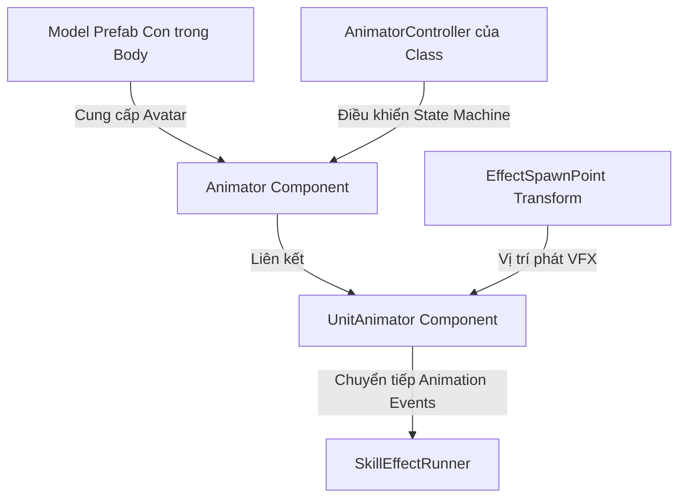
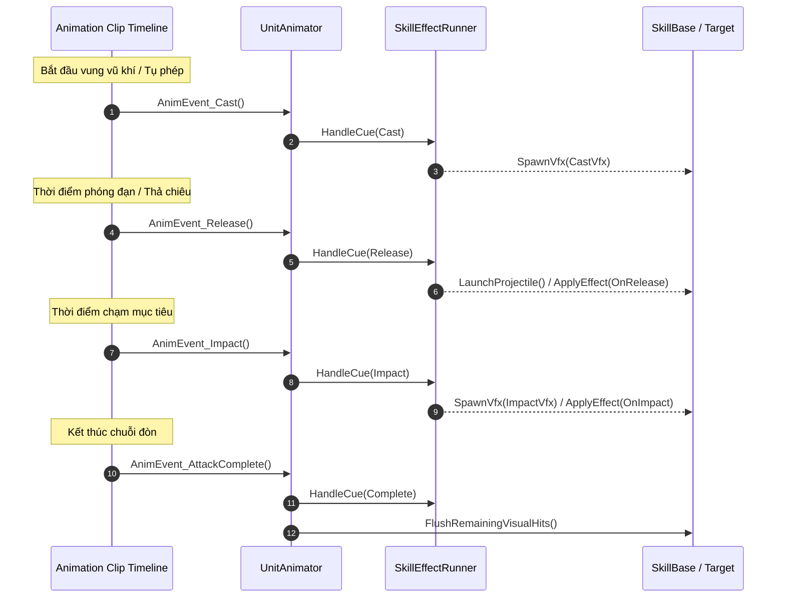

# Workflow Cấu Hình Animation, Vũ Khí & Event Cues Cho Unit

Tài liệu quy định quy trình chuẩn để thiết lập Animator, Avatar Humanoid, gắn vũ khí/khiên vào socket xương bàn tay, và đồng bộ Animation Events với hệ thống Skill VFX ([`SkillEffectRunner`](file:///e:/UnityProject/My%20Turnbased/turnbased_2025/Assets/Scripts/Unit/SkillEffectRunner.cs) và [`UnitAnimator`](file:///e:/UnityProject/My%20Turnbased/turnbased_2025/Assets/Scripts/Unit/UnitAnimator.cs)).

Quy trình này áp dụng sau khi đã có Model Prefab xuất từ [Synty_Sidekick_Character_Creation_Workflow.md](file:///e:/UnityProject/My%20Turnbased/turnbased_2025/Assets/Docs/Systems%20docs/Synty_Sidekick_Character_Creation_Workflow.md).

---

## 1. Cấu Hình Animator & Avatar Humanoid

Thực hiện trên GameObject con `Body` của Unit Prefab (`Assets/MyGame/Resource/Unit/<ClassName>.prefab`):

### 1.1. Cập nhật Component `Animator`
- **Node vị trí**: GameObject `Body` (Transform `Scale = (1.5, 1.5, 1.5)`).
- **Avatar**: Kéo Avatar Humanoid tương ứng của model:
  - Nếu xuất qua FBX: Chọn sub-asset `Avatar` bên trong file `Meshes/<CharacterName>.fbx`.
  - Nếu lưu qua runtime asset của Synty Sidekick: Kéo file asset `Meshes/<CharacterName>-avatar.asset`.
  - Đảm bảo rig type của Avatar là **Humanoid** và không có lỗi cấu trúc xương.
- **Controller**: Gán `AnimatorController` tương ứng của class nhân vật (ví dụ: `Knight.controller`, `Archer.controller`, `Militia_Override.controller`...).
- **Apply Root Motion**: Đặt **TẮT (Unchecked)** vì việc di chuyển đơn vị được điều khiển bởi grid movement system qua [`UnitController`](file:///e:/UnityProject/My%20Turnbased/turnbased_2025/Assets/Scripts/Unit/UnitController.cs).

### 1.2. Cấu hình Component [`UnitAnimator`](file:///e:/UnityProject/My%20Turnbased/turnbased_2025/Assets/Scripts/Unit/UnitAnimator.cs)
- `animator`: Kéo tham chiếu `Animator` trên cùng GameObject `Body`.
- `_effectSpawnPoint`: Kéo Transform node `EffectSpawnPoint` (nằm ở root hoặc ngang tầm ngực nhân vật). Đây là vị trí xuất phát mặc định của projectile hoặc VFX tụ năng lượng.
- `_transitionDuration`: Mặc định `0.1` giây (thời gian hòa trộn animation crossfade).
- `_skillEffectRunner`: Để trống nếu muốn script tự động `AddComponent<SkillEffectRunner>` lúc `Awake()`, hoặc kéo component [`SkillEffectRunner`](file:///e:/UnityProject/My%20Turnbased/turnbased_2025/Assets/Scripts/Unit/SkillEffectRunner.cs) trên cùng node.

---

## 2. Gắn Vũ Khí & Khiên (Weapon & Shield Sockets)

### 2.1. Xác định Sockets Trên Khung Xương Model
Trong hierarchy của Model Prefab (nằm dưới `Body`), tìm đến các xương/socket bàn tay:
- **Tay phải (Thuận đòn đánh chính / Cầm vũ khí)**:
  - Socket phụ trợ (nếu có): `.../Root/.../Spine/.../Item_Hand_R`.
  - Hoặc xương bàn tay: `RightHand`, `middle_03_r` hoặc `hand_r`.
- **Tay trái (Cầm khiên / Cung / Song đao)**:
  - Socket phụ trợ (nếu có): `.../Root/.../Spine/.../Item_Hand_L`.
  - Hoặc xương bàn tay: `LeftHand`, `middle_03_l` hoặc `hand_l`.

### 2.2. Danh Sách Vũ Khí & Nguồn Prefab Theo Class

| Class | Tay Phải (`Item_Hand_R`) | Tay Trái (`Item_Hand_L`) | Đường Dẫn Prefab Vũ Khí | Ghi Chú Nguồn Asset |
|---|---|---|---|---|
| **Berserker** | `Weapon_Smasher` (Chùy gai) | *(Trống)* | `Assets/MyGame/Resource/Unit/Weapons/Weapon_Smasher.prefab` | Sẵn có |
| **Knight** | `Weapon_Knight` (Kiếm hiệp sĩ) | `Shield_Knight` (Khiên) | `Assets/MyGame/Resource/Unit/Weapons/Weapon_Knight.prefab` `Assets/MyGame/Resource/Unit/Weapons/Shield_Knight.prefab` | Sẵn có |
| **Magician** | Trượng phép / Wand | *(Trống)* | `Assets/MyGame/Resource/Unit/Weapons/Weapon_Magician.prefab` | Tạo từ `Assets/Blink/.../Staff_Basic.prefab` hoặc `Wand_Basic.prefab` |
| **Smasher** | `Weapon_Smasher1` (Đại búa) | *(Trống)* | `Assets/MyGame/Resource/Unit/Weapons/Weapon_Smasher1.prefab` | Sẵn có |
| **Halberdier** | `Spear_Medium` (Trường thương) | *(Trống)* | `Assets/MyGame/Resource/Unit/Weapons/Spear_Medium.prefab` | Sẵn có |
| **Assassin** | Đoản đao 1 | Đoản đao 2 | `Assets/MyGame/Resource/Unit/Weapons/Weapon_Assassin_R.prefab` `Assets/MyGame/Resource/Unit/Weapons/Weapon_Assassin_L.prefab` | Tạo từ `Assets/Blink/.../Axe1H_Basic.prefab` hoặc Dagger |
| **Archer** | *(Trống hoặc bao ngón)* | `Weapon_Archer` (Cung) | `Assets/MyGame/Resource/Unit/Weapons/Weapon_Archer.prefab` | Sẵn có (Cung cầm tay trái, kéo dây tay phải) |
| **Militia** | `Weapon_soldier` (Kiếm ngắn) | *(Trống)* | `Assets/MyGame/Resource/Unit/Weapons/Weapon_soldier.prefab` | Sẵn có |
| **Herbalist** | Gậy hành hương / Thảo mộc | *(Trống)* | `Assets/MyGame/Resource/Unit/Weapons/Weapon_Herbalist.prefab` | Tạo từ `Assets/Blink/.../Staff_Medium.prefab` |
| **Adjudicator** | Quyền trượng phán quan | *(Trống)* | `Assets/MyGame/Resource/Unit/Weapons/Weapon_Adjudicator.prefab` | Tạo từ `Assets/Blink/.../Mace1H_Basic.prefab` hoặc Wand |

> [!NOTE]
> Đối với các vũ khí chưa có trong `Assets/MyGame/Resource/Unit/Weapons/`:
> 1. Mở thư mục nguồn: `Assets/Blink/Art/Weapons/LowPoly/FreeRPGWeapons/_PREFABS/`.
> 2. Kéo model vũ khí tương ứng thành Prefab Variant hoặc nhân bản vào `Assets/MyGame/Resource/Unit/Weapons/`.
> 3. Đặt tên thống nhất theo chuẩn `Weapon_<ClassName>.prefab`.

### 2.3. Quy Trình Gắn & Canh Chỉnh Transform
1. Kéo thả Prefab vũ khí từ `Assets/MyGame/Resource/Unit/Weapons/` vào làm con của đúng Transform xương/socket bàn tay.
2. Đặt `Scale = (1, 1, 1)` (hoặc chỉnh tỷ lệ cân đối với bàn tay Synty).
3. Chỉnh `Position` và `Rotation` trong Scene View để chuôi vũ khí nằm gọn vào lòng bàn tay.
4. Chuyển Animator sang clip Attack hoặc Idle trong cửa sổ Animation để kiểm tra vũ khí di chuyển tự nhiên theo cử động xương bàn tay trong suốt chuỗi hành động.

---

## 3. Cấu Hình Animation Events Khớp Với VFX Cues

Hệ thống kỹ năng dựa trên [`UnitAnimator`](file:///e:/UnityProject/My%20Turnbased/turnbased_2025/Assets/Scripts/Unit/UnitAnimator.cs) để bắt các mốc thời gian trên timeline animation và chuyển tiếp tới [`SkillEffectRunner`](file:///e:/UnityProject/My%20Turnbased/turnbased_2025/Assets/Scripts/Unit/SkillEffectRunner.cs) thi triển hiệu ứng tương ứng.

### 3.1. Danh Sách Các Animation Events Chuẩn

Các hàm sau đây được khai báo công khai trong [`UnitAnimator.cs`](file:///e:/UnityProject/My%20Turnbased/turnbased_2025/Assets/Scripts/Unit/UnitAnimator.cs#L99-L162) và phải được gõ chính xác từng ký tự trong Animation Event Inspector:

1. **`AnimEvent_Cast`**:
   - **Thời điểm**: Ngay khi nhân vật bắt đầu tụ phép hoặc chuẩn bị vung đòn.
   - **Tác vụ**: Kích hoạt `CastVfxPrefab` tại vị trí cast (thường là ngực hoặc dưới chân caster).
   - **Áp dụng**: Các kỹ năng có thời gian tụ hoặc niệm ấn (ví dụ: `Accusation`, `Forbidden Seal`, `Purification`).

2. **`AnimEvent_Release`**:
   - **Thời điểm**: Khung hình cung thủ thả dây cung, pháp sư bắn tia phép từ đầu gậy, hoặc kiếm sĩ vung ra luồng khí kiếm.
   - **Tác vụ**: Sinh projectile và bay về mục tiêu; kích hoạt hiệu ứng áp dụng nếu kỹ năng cấu hình `SkillEffectApplyTiming.OnRelease`.
   - **Bắt buộc cho**: `Normal Arrow`, `Multi Strike Arrow`, `Fire Seal`, `Quick Slash`...

3. **`AnimEvent_Impact`**:
   - **Thời điểm**: Khung hình vũ khí melee chạm trúng người nạn nhân, hoặc phép diện rộng nổ tung.
   - **Tác vụ**: Sinh `ImpactVfxPrefab`, rung lắc, trừ máu/hiển thị số sát thương và kích hoạt hiệu ứng debuff/knockback.
   - **Bắt buộc cho**: Tất cả đòn đánh cận chiến (`Slash attack`, `Blood Hammer`, `Earthquake`, `Holy Sword Stance`, `Power Strike`...).

4. **`AnimEvent_AttackComplete`**:
   - **Thời điểm**: Khung hình cuối cùng của animation tấn công khi nhân vật bắt đầu thu thế về Idle.
   - **Tác vụ**: Hủy safety timer, dọn dẹp các hit visual còn sót (`FlushRemainingVisualHits()`) và trả trạng thái lượt cho [`UnitController`](file:///e:/UnityProject/My%20Turnbased/turnbased_2025/Assets/Scripts/Unit/UnitController.cs).

5. **`AnimEvent_SkillCue` (Hàm tham số String)**:
   - Dùng khi cần gọi linh hoạt qua tham số chuỗi: nhập tham số `Cast`, `Release`, `Impact` hoặc `Complete`.

### 3.2. Quy Tắc Gắn Event Lên Animation Clip

1. Mở cửa sổ **Animation** (`Window > Animation > Animation`).
2. Chọn GameObject `Body` của nhân vật trên Scene (hoặc chọn trực tiếp asset Animation Clip của class).
3. Di chuyển con trỏ thời gian (Scrubber) đến đúng frame mong muốn:
   * **Đòn cận chiến Melee**: Gắn `AnimEvent_Impact` tại frame vũ khí chém chạm mục tiêu; gắn `AnimEvent_AttackComplete` ở gần cuối clip.
   * **Đòn bắn xa Ranged / Projectile**: Gắn `AnimEvent_Release` tại frame mũi tên rời cung / phép rời tay; gắn `AnimEvent_AttackComplete` ở cuối clip.
   * **Kỹ năng đa đoạn (Multi-hit)**: Có thể gắn nhiều `AnimEvent_Impact` tương ứng với mỗi lần chém trúng đích trong animation.
4. Nhấn nút **Add Event** (biểu tượng vạch kẻ có dấu cộng nhỏ dưới thước đo thời gian).
5. Trong cửa sổ **Inspector**, chọn hàm tương ứng từ danh sách dropdown của [`UnitAnimator`](file:///e:/UnityProject/My%20Turnbased/turnbased_2025/Assets/Scripts/Unit/UnitAnimator.cs).

---

## 4. Kiểm Tra & Xác Nhận (Checklist)

Trước khi chuyển sang bước cấu hình `UnitData` và Catalog:
- [ ] GameObject `Body` có scale đúng `(1.5, 1.5, 1.5)`.
- [ ] Avatar Humanoid được gán chính xác, không có lỗi "Avatar has no humanoid mapping".
- [ ] AnimatorController trỏ đúng controller của class tương ứng.
- [ ] Transform `_effectSpawnPoint` đã được kéo vào [`UnitAnimator`](file:///e:/UnityProject/My%20Turnbased/turnbased_2025/Assets/Scripts/Unit/UnitAnimator.cs).
- [ ] Vũ khí/khiên đã nằm đúng socket bàn tay, không bị quay ngược đầu hoặc lệch khỏi lòng bàn tay.
- [ ] Các Animation Clip tấn công đều có tối thiểu một event kích hoạt sát thương (`AnimEvent_Impact` hoặc `AnimEvent_Release`) và một event kết thúc (`AnimEvent_AttackComplete`).
- [ ] Không có thông báo lỗi `AnimationEvent '...' has no receiver!` trên Unity Console khi phát thử animation.

