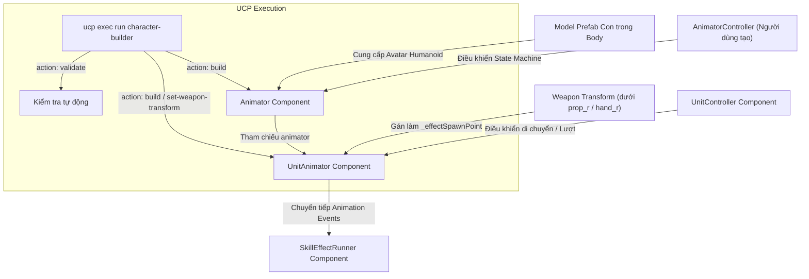

# Workflow Giai Đoạn 1: Cấu Hình Animator, Avatar Humanoid & Vũ Khí Cho Unit (UCP tích hợp)

Tài liệu quy định quy trình chuẩn để thiết lập Animator, Avatar Humanoid, gắn vũ khí và cấu hình component [`UnitAnimator`](file:///e:/UnityProject/My%20Turnbased/turnbased_2025/Assets/Scripts/Unit/UnitAnimator.cs) trên GameObject `Body` của Unit Prefab (`Assets/MyGame/Resource/Unit/<ClassName>.prefab`), sử dụng công cụ tự động hóa qua Unity Control Protocol (`ucp` CLI).

Quy trình này áp dụng sau khi đã có Model Prefab xuất từ [Synty_Sidekick_Character_Creation_Workflow.md](file:///e:/UnityProject/My%20Turnbased/turnbased_2025/Assets/Docs/Workflow/Synty_Sidekick_Character_Creation_Workflow.md).

> [!IMPORTANT]
> **QUY TẮC SỬ DỤNG UNITY CONTROL PROTOCOL (UCP)**:
> Mọi bước gán Avatar, cấu hình scale `Body`, gắn vũ khí, gán AnimatorController và nghiệm thu tính hợp lệ phải được thực hiện qua lệnh `ucp --bridge-update-policy off exec run character-builder` trên bridge `UCP.Bridge.IUCPScript`.

---

## 1. Kiến Trúc & Luồng Liên Kết



---

## 2. Tiêu Chuẩn Kỹ Thuật

### 2.1. Chuẩn Bị Hierarchy Node & Vũ Khí
- **Node mục tiêu**: GameObject con `Body` nằm trực tiếp dưới root của Unit Prefab.
- **Transform Scale**: Cố định `Scale = (1.5, 1.5, 1.5)` trên node `Body` để đồng bộ kích thước chuẩn giữa model Synty và grid map.
- **Vũ khí & Socket**: Prefab vũ khí đặt trong `Assets/MyGame/Resource/Unit/Weapons/` được gắn làm con của xương bàn tay phải theo thứ tự ưu tiên: `prop_r` -> `hand_r` -> `ring_01_r`.

### 2.2. Cấu Hình Component `Animator`
- **Avatar**: Gán Humanoid Avatar tương ứng của model:
  - Sub-asset `Avatar` trong `Meshes/<CharacterName>.fbx` hoặc file asset `Meshes/<CharacterName>-avatar.asset`.
  - Rig type của Avatar phải là **Humanoid** (`avatar.isHuman == true`).
- **Controller**: Gán file `AnimatorController` hoặc `AnimatorOverrideController` do người dùng tạo trong `Assets/MyGame/Animations/` (ví dụ: `Assets/MyGame/Animations/<ClassName>.controller` hoặc `<ClassName>_Override.overrideController`).
  - *Các Controller hiện có sẵn trong dự án*: `Adjudicator.controller`, `Archer.controller`, `Assassin.controller`, `Axe.controller`, `GreatSword.controller`, `Knight.controller`, `Magician.controller`, `Smasher.controller`, `Herbalist_Override.overrideController`, `Militia_Override.overrideController`.
- **Apply Root Motion**: **TẮT (Unchecked)**.
  > [!IMPORTANT]
  > Việc di chuyển đơn vị trên grid được kiểm soát hoàn toàn bởi [`UnitController`](file:///e:/UnityProject/My%20Turnbased/turnbased_2025/Assets/Scripts/Unit/UnitController.cs). Bật Apply Root Motion sẽ làm nhân vật lệch khỏi tọa độ grid tile khi phát animation. Lưu ý: lệnh `validate` hiện tại chưa tự động kiểm tra cờ `applyRootMotion`, cần kiểm tra mục này trên Inspector hoặc giữ nguyên từ `baseUnitPrefabPath`.

### 2.3. Cấu Hình Component [`UnitAnimator`](file:///e:/UnityProject/My%20Turnbased/turnbased_2025/Assets/Scripts/Unit/UnitAnimator.cs)
- `animator`: Gán `Animator` trên cùng GameObject `Body`.
- `_effectSpawnPoint`: Trỏ trực tiếp vào **Transform của vũ khí** vừa gắn vào bàn tay (script `character-builder` tự động liên kết khi chạy `build` hoặc `set-weapon-transform`; chỉ fallback về node `EffectSpawnPoint` nếu nhân vật không có vũ khí).
- `_transitionDuration`: Mặc định `0.1` giây.
- `_skillEffectRunner`: Gán component [`SkillEffectRunner`](file:///e:/UnityProject/My%20Turnbased/turnbased_2025/Assets/Scripts/Unit/SkillEffectRunner.cs) (hoặc để trống để tự sinh lúc `Awake()`).

---

## 3. Thực Thi Tự Động Hóa Qua UCP CLI

Hệ thống cung cấp script Editor [`CharacterBuilder.cs`](file:///e:/UnityProject/My%20Turnbased/turnbased_2025/Assets/Scripts/Editor/CharacterBuilder.cs) triển khai `IUCPScript` với tên `character-builder`.

### 3.1. Biên Dịch & Đảm Bảo Trạng Thái Editor
```powershell
ucp --bridge-update-policy off compile --json
```

### 3.2. Chạy Build Prefab Tự Động Bằng UCP
Thực thi lệnh UCP sau để tự động tạo hoặc cấu hình lại Unit Prefab (gán `Body` scale 1.5, Avatar Humanoid, Animator Controller, gắn vũ khí, liên kết `UnitAnimator._effectSpawnPoint` vào vũ khí, nạp `UnitData`/`StartingSkills` và rebuild `MatchContentCatalog`):

```powershell
ucp --bridge-update-policy off exec run character-builder --parameters '{
  "action": "build",
  "className": "<ClassName>",
  "baseUnitPrefabPath": "Assets/MyGame/Resource/Unit/Knight.prefab",
  "modelPrefabPath": "Assets/MyGame/Prefabs/Model/<ClassName>_M/<ClassName>.prefab",
  "weaponPrefabPath": "Assets/MyGame/Resource/Unit/Weapons/Weapon_<ClassName>.prefab",
  "weaponBoneName": "prop_r",
  "unitDataPath": "Assets/Scripts/Data/<ClassName> Data.asset",
  "animatorControllerPath": "Assets/MyGame/Animations/<ClassName>.controller",
  "outputPrefabPath": "Assets/MyGame/Resource/Unit/<ClassName>.prefab"
}' --json
```

### 3.3. Tinh Chỉnh Transform Vũ Khí (Nếu Cần)
Nếu vị trí/góc xoay của vũ khí cần điều chỉnh sau khi build, chạy action `set-weapon-transform` (tự động cập nhật lại `_effectSpawnPoint` trỏ vào vũ khí):

```powershell
ucp --bridge-update-policy off exec run character-builder --parameters '{
  "action": "set-weapon-transform",
  "className": "<ClassName>",
  "weaponBoneName": "prop_r",
  "weaponLocalPos": {"x": 0.033, "y": 0.016, "z": 0.002},
  "weaponLocalEuler": {"x": -2.5, "y": -94.0, "z": 88.0},
  "weaponLocalScale": {"x": 1.0, "y": 1.0, "z": 1.0}
}' --json
```

### 3.4. Kiểm Tra Tính Hợp Lệ (Validate) Qua UCP
Kiểm tra tự động xem Avatar, Scale `Body`, Controller, `UnitData.StartingSkills` và `_effectSpawnPoint` trên Prefab đã đúng chuẩn hay chưa:

```powershell
ucp --bridge-update-policy off exec run character-builder --parameters '{
  "action": "validate",
  "className": "<ClassName>"
}' --json
```

Kết quả trả về yêu cầu:
- `"valid": true`
- Mảng `"errors"` rỗng `[]`.

---

## 4. Checklist Kiểm Tra & Nghiệm Thu Qua UCP

- [ ] Lệnh `ucp --bridge-update-policy off compile --json` hoàn tất không có lỗi script.
- [ ] Lệnh `character-builder` với action `validate` trả về `"valid": true`.
- [ ] GameObject `Body` có scale đúng `(1.5, 1.5, 1.5)`.
- [ ] Avatar Humanoid hợp lệ (`isHuman: true`, không có lỗi thiếu ánh xạ xương).
- [ ] Animator Controller trỏ đúng controller của class.
- [ ] `Apply Root Motion` trên `Animator` đã tắt (kiểm tra trên Inspector).
- [ ] Tham chiếu `_effectSpawnPoint` trên [`UnitAnimator`](file:///e:/UnityProject/My%20Turnbased/turnbased_2025/Assets/Scripts/Unit/UnitAnimator.cs) trỏ đúng vào Transform của vũ khí.

---

## 5. Bước Tiếp Theo Trong Chuỗi Workflow
Sau khi hoàn tất cấu hình Animator, Avatar Humanoid và Vũ khí, tiếp tục với:
- [Character_Animation_Events_VFX_Setup_Workflow.md](file:///e:/UnityProject/My%20Turnbased/turnbased_2025/Assets/Docs/Workflow/Character_Animation_Events_VFX_Setup_Workflow.md): Cấu hình và kiểm chứng Animation Events khớp với VFX Cues qua UCP.
