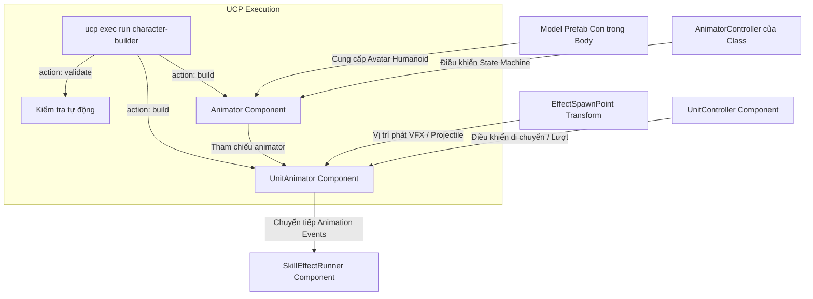

# Workflow Cấu Hình Animator & Avatar Humanoid Cho Unit (UCP tích hợp)

Tài liệu quy định quy trình chuẩn để thiết lập Animator, Avatar Humanoid và component [`UnitAnimator`](file:///e:/UnityProject/My%20Turnbased/turnbased_2025/Assets/Scripts/Unit/UnitAnimator.cs) trên GameObject `Body` của Unit Prefab (`Assets/MyGame/Resource/Unit/<ClassName>.prefab`), sử dụng công cụ tự động hóa qua Unity Control Protocol (`ucp` CLI).

Quy trình này áp dụng sau khi đã có Model Prefab xuất từ [Synty_Sidekick_Character_Creation_Workflow.md](file:///e:/UnityProject/My%20Turnbased/turnbased_2025/Assets/Docs/Workflow/Synty_Sidekick_Character_Creation_Workflow.md).

> [!IMPORTANT]
> **YÊU CẦU BẮT BUỘC SỬ DỤNG UNITY CONTROL PROTOCOL (UCP)**:
> Mọi bước gán Avatar, cấu hình scale `Body`, AnimatorController và kiểm tra tính hợp lệ phải được thực hiện hoặc nghiệm thu qua lệnh `ucp exec run character-builder` trên bridge `UCP.Bridge.IUCPScript`.

---

## 1. Kiến Trúc & Luồng Liên Kết



---

## 2. Tiêu Chuẩn Kỹ Thuật

### 2.1. Chuẩn Bị Hierarchy Node
- **Node mục tiêu**: GameObject con `Body` nằm trực tiếp dưới root của Unit Prefab.
- **Transform Scale**: Cố định `Scale = (1.5, 1.5, 1.5)` trên node `Body` để đồng bộ kích thước chuẩn giữa model Synty và grid map.
- **Node EffectSpawnPoint**: GameObject rỗng tên `EffectSpawnPoint` đặt ngang tầm ngực hoặc root nhân vật để làm điểm phát VFX/projectile.

### 2.2. Cấu Hình Component `Animator`
- **Avatar**: Gán Humanoid Avatar tương ứng của model:
  - Sub-asset `Avatar` trong `Meshes/<CharacterName>.fbx` hoặc file asset `Meshes/<CharacterName>-avatar.asset`.
  - Rig type của Avatar phải là **Humanoid** (`avatar.isHuman == true`).
- **Controller**: Gán file `AnimatorController` tương ứng của class nhân vật (ví dụ: `Assets/MyGame/Animations/<ClassName>/<ClassName>.controller`).
- **Apply Root Motion**: **TẮT (Unchecked)**.
  > [!IMPORTANT]
  > Việc di chuyển đơn vị trên grid được kiểm soát hoàn toàn bởi [`UnitController`](file:///e:/UnityProject/My%20Turnbased/turnbased_2025/Assets/Scripts/Unit/UnitController.cs). Bật Apply Root Motion sẽ làm nhân vật lệch khỏi tọa độ grid tile khi phát animation.

### 2.3. Cấu Hình Component [`UnitAnimator`](file:///e:/UnityProject/My%20Turnbased/turnbased_2025/Assets/Scripts/Unit/UnitAnimator.cs)
- `animator`: Gán `Animator` trên cùng GameObject `Body`.
- `_effectSpawnPoint`: Kéo Transform node `EffectSpawnPoint`.
- `_transitionDuration`: Mặc định `0.1` giây.
- `_skillEffectRunner`: Gán component [`SkillEffectRunner`](file:///e:/UnityProject/My%20Turnbased/turnbased_2025/Assets/Scripts/Unit/SkillEffectRunner.cs) (hoặc để trống để tự sinh lúc `Awake()`).

---

## 3. Thực Thi Tự Động Hóa Qua UCP CLI

Hệ thống cung cấp script Editor [`CharacterBuilder.cs`](file:///e:/UnityProject/My%20Turnbased/turnbased_2025/Assets/Scripts/Editor/CharacterBuilder.cs) triển khai `IUCPScript` với tên `character-builder`.

### 3.1. Biên Dịch & Đảm Bảo Trạng Thái Editor
```powershell
ucp --bridge-update-policy off compile --json
```

### 3.2. Chạy Build Prefab Tự Động Bằng UCP
Thực thi lệnh UCP sau để tự động tạo hoặc cấu hình lại Unit Prefab (gán `Body` scale 1.5, Avatar Humanoid, Animator Controller và cập nhật tham chiếu `UnitAnimator`):

```powershell
ucp --bridge-update-policy off exec run character-builder --parameters '{
  "action": "build",
  "className": "<ClassName>",
  "baseUnitPrefabPath": "Assets/MyGame/Resource/Unit/Knight.prefab",
  "modelPrefabPath": "Assets/MyGame/Prefabs/Model/<ClassName>_M/<ClassName>.prefab",
  "animatorControllerPath": "Assets/MyGame/Animations/<ClassName> Anims/<ClassName>.controller",
  "outputPrefabPath": "Assets/MyGame/Resource/Unit/<ClassName>.prefab"
}' --json
```

### 3.3. Kiểm Tra Tính Hợp Lệ (Validate) Qua UCP
Kiểm tra tự động xem Avatar, Scale `Body`, Controller và các tham chiếu trên Prefab đã đúng chuẩn hay chưa:

```powershell
ucp --bridge-update-policy off exec run character-builder --parameters '{
  "action": "validate",
  "className": "<ClassName>"
}' --json
```

Kết quả trả về yêu cầu:
- `"valid": true`
- Mảng `"errors"` rỗng `[]`.

---

## 4. Checklist Kiểm Tra & Nghiệm Thu Qua UCP

- [ ] Lệnh `ucp compile` hoàn tất không có lỗi script.
- [ ] Lệnh `character-builder` với action `validate` trả về `"valid": true`.
- [ ] GameObject `Body` có scale đúng `(1.5, 1.5, 1.5)`.
- [ ] Avatar Humanoid hợp lệ (`isHuman: true`, không có lỗi thiếu ánh xạ xương).
- [ ] Animator Controller trỏ đúng controller của class.
- [ ] `Apply Root Motion` đã tắt.
- [ ] Tham chiếu `_effectSpawnPoint` trên [`UnitAnimator`](file:///e:/UnityProject/My%20Turnbased/turnbased_2025/Assets/Scripts/Unit/UnitAnimator.cs) không bị null.

---

## 5. Bước Tiếp Theo Trong Chuỗi Workflow
Sau khi hoàn tất cấu hình Animator & Avatar Humanoid, tiếp tục với:
- [Character_Weapon_Shield_Setup_Workflow.md](file:///e:/UnityProject/My%20Turnbased/turnbased_2025/Assets/Docs/Workflow/Character_Weapon_Shield_Setup_Workflow.md): Gắn vũ khí và khiên vào socket bàn tay qua UCP.

## 5. Bước Tiếp Theo Trong Chuỗi Workflow
Sau khi hoàn tất cấu hình Animator & Avatar Humanoid, tiếp tục với:
- [Character_Weapon_Shield_Setup_Workflow.md](file:///e:/UnityProject/My%20Turnbased/turnbased_2025/Assets/Docs/Workflow/Character_Weapon_Shield_Setup_Workflow.md): Gắn vũ khí và khiên vào socket bàn tay qua UCP.
---