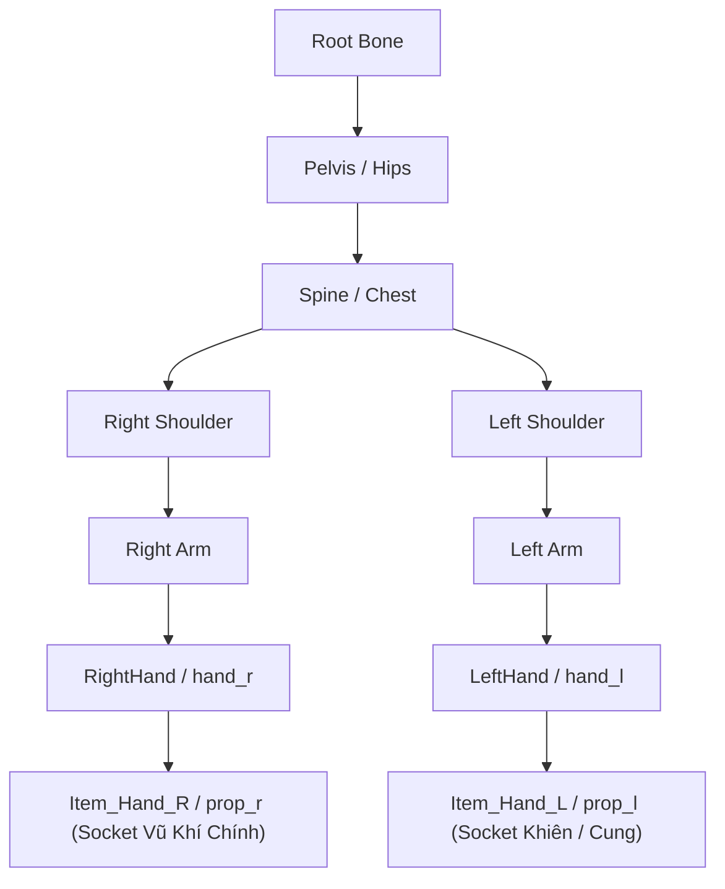

# Workflow Gắn Vũ Khí & Khiên (Weapon & Shield Sockets) Cho Unit (UCP tích hợp)

Tài liệu quy định quy trình chuẩn để gắn vũ khí và khiên vào đúng socket khung xương bàn tay của nhân vật trên Unit Prefab (`Assets/MyGame/Resource/Unit/<ClassName>.prefab`), căn chỉnh Transform và kiểm tra độ chính xác của tay cầm qua công cụ tự động hóa Unity Control Protocol (`ucp` CLI).

Quy trình này áp dụng sau khi đã hoàn tất cấu hình Animator và Avatar theo [Character_Animator_Avatar_Setup_Workflow.md](file:///e:/UnityProject/My%20Turnbased/turnbased_2025/Assets/Docs/Workflow/Character_Animator_Avatar_Setup_Workflow.md).

> [!IMPORTANT]
> **YÊU CẦU BẮT BUỘC SỬ DỤNG UNITY CONTROL PROTOCOL (UCP)**:
> Việc gắn vũ khí, căn chỉnh thông số Transform (Position, Rotation, Scale) và chụp ảnh kiểm chứng visual qua các animation clip phải được thực hiện bằng lệnh UCP thông qua script `character-builder`. Không thực hiện kéo thả ước lượng bằng mắt nếu chưa chạy kiểm chứng UCP.

---

## 1. Xác Định Sockets Khung Xương Bàn Tay

Trong Hierarchy của Model Prefab (nằm bên dưới GameObject `Body`), duyệt cây xương để tìm đến các socket/xương bàn tay:



- **Tay phải (Thuận đòn đánh chính / Cầm vũ khí)**:
  - Socket phụ trợ chuẩn trên rig Synty: `.../Root/.../Spine/.../prop_r` hoặc `Item_Hand_R`.
  - Fallback xương bàn tay: `hand_r`, `RightHand` hoặc `ring_01_r`.
- **Tay trái (Cầm khiên / Cung / Song đao)**:
  - Socket phụ trợ chuẩn trên rig Synty: `.../Root/.../Spine/.../prop_l` hoặc `Item_Hand_L`.
  - Fallback xương bàn tay: `hand_l`, `LeftHand` hoặc `ring_01_l`.

---

## 2. Danh Sách Vũ Khí & Nguồn Prefab Theo Class

| Class | Tay Phải (`prop_r` / `Item_Hand_R`) | Tay Trái (`prop_l` / `Item_Hand_L`) | Đường Dẫn Prefab Vũ Khí | Ghi Chú Nguồn Asset |
|---|---|---|---|---|
| **Berserker** | `Weapon_Smasher` (Chùy gai) | *(Trống)* | `Assets/MyGame/Resource/Unit/Weapons/Weapon_Smasher.prefab` | Sẵn có |
| **Knight** | `Weapon_Knight` (Kiếm hiệp sĩ) | `Shield_Knight` (Khiên) | `Assets/MyGame/Resource/Unit/Weapons/Weapon_Knight.prefab`<br/>`Assets/MyGame/Resource/Unit/Weapons/Shield_Knight.prefab` | Sẵn có |
| **Magician** | Trượng phép / Wand | *(Trống)* | `Assets/MyGame/Resource/Unit/Weapons/Weapon_Magician.prefab` | Nguồn: `Assets/Blink/.../Staff_Basic.prefab` |
| **Smasher** | `Weapon_Smasher1` (Đại búa) | *(Trống)* | `Assets/MyGame/Resource/Unit/Weapons/Weapon_Smasher1.prefab` | Sẵn có |
| **Halberdier** | `Spear_Medium` (Trường thương) | *(Trống)* | `Assets/MyGame/Resource/Unit/Weapons/Spear_Medium.prefab` | Sẵn có |
| **Assassin** | Đoản đao 1 | Đoản đao 2 | `Assets/MyGame/Resource/Unit/Weapons/Weapon_Assassin_R.prefab`<br/>`Assets/MyGame/Resource/Unit/Weapons/Weapon_Assassin_L.prefab` | Nguồn: `Assets/Blink/.../Axe1H_Basic.prefab` |
| **Archer** | *(Trống hoặc bao ngón)* | `Weapon_Archer` (Cung) | `Assets/MyGame/Resource/Unit/Weapons/Weapon_Archer.prefab` | Sẵn có (Cung cầm tay trái, kéo dây tay phải) |
| **Militia** | `Weapon_soldier` (Kiếm ngắn) | *(Trống)* | `Assets/MyGame/Resource/Unit/Weapons/Weapon_soldier.prefab` | Sẵn có |
| **Herbalist** | Gậy hành hương / Thảo mộc | *(Trống)* | `Assets/MyGame/Resource/Unit/Weapons/Weapon_Herbalist.prefab` | Nguồn: `Assets/Blink/.../Staff_Medium.prefab` |
| **Adjudicator** | Quyền trượng phán quan | *(Trống)* | `Assets/MyGame/Resource/Unit/Weapons/Weapon_Adjudicator.prefab` | Nguồn: `Assets/Blink/.../Mace1H_Basic.prefab` |

---

## 3. Thực Thi Tự Động Hóa Qua UCP CLI

### 3.1. Gắn & Căn Chỉnh Vũ Khí Bằng UCP (`set-weapon-transform`)
Lệnh này tự động tìm kiếm vũ khí, gán làm con của đúng bone/socket, áp đặt thông số Local Transform chuẩn và cập nhật `_effectSpawnPoint` của [`UnitAnimator`](file:///e:/UnityProject/My%20Turnbased/turnbased_2025/Assets/Scripts/Unit/UnitAnimator.cs):

```powershell
ucp --bridge-update-policy off exec run character-builder --parameters '{
  "action": "set-weapon-transform",
  "className": "<ClassName>",
  "weaponBoneName": "prop_r",
  "weaponLocalPos": {"x": 0.033, "y": 0.016, "z": 0.002},
  "weaponLocalEuler": {"x": -2.5, "y": -94.0, "z": 88.0},
  "weaponLocalScale": {"x": 1.0, "y": 1.0, "z": 1.0}
}' --json
```

*(Lưu ý: Đối với vũ khí dạng trượng đứng như của `Adjudicator` hoặc `Herbalist`, giá trị xoay chuẩn là `Euler = (180, 0, 0)` và `Pos = (-0.014, -0.15, -0.033)`).*

### 3.2. Kiểm Tra Chuyển Động & Chụp Ảnh Visual Bằng UCP (`check-animation`)
Lệnh này tự động khởi tạo nhân vật trong scene tạm, sample qua các clip `Idle`, `Run`, `Attack`, `Cast`, đo đạc tọa độ lòng bàn tay so với thân vũ khí và tự động render ảnh chụp đa góc (toàn thân, cận cảnh trước, cận cảnh bên hông) vào thư mục `Artifacts/`:

```powershell
ucp --bridge-update-policy off exec run character-builder --parameters '{
  "action": "check-animation",
  "className": "<ClassName>"
}' --json
```

Kết quả trả về qua JSON gồm:
- `radialDistanceToStaff`: Khoảng cách từ trục thân vũ khí đến lòng bàn tay (càng nhỏ càng sát tay cầm).
- `alongStaffOffset`: Điểm nắm trên chiều dài thân vũ khí.
- Danh sách đường dẫn ảnh visual: `Artifacts/anim_<clip>.png`, `Artifacts/anim_close_<clip>.png`, `Artifacts/<ClassName>_Preview.png`.

---

## 4. Checklist Kiểm Tra & Nghiệm Thu Qua UCP

- [ ] Lệnh `set-weapon-transform` thực thi thành công và cập nhật Prefab trên đĩa.
- [ ] Lệnh `check-animation` trả về `"success": true` và không bị lỗi sampling.
- [ ] Mở và kiểm tra các ảnh chụp trong thư mục `Artifacts/`:
  - [ ] Bàn tay nắm trọn vẹn chuôi vũ khí, không bị lệch hoặc đâm xuyên tay.
  - [ ] Khiên bám chắc vào cẳng tay trái và hướng mặt phẳng chắn về phía trước.
  - [ ] Vũ khí xoay đúng chiều lưỡi/mũi đánh trong cả clip `Idle`, `Run` và `Attack`.
- [ ] Tham chiếu `UnitAnimator._effectSpawnPoint` đã được tự động liên kết tới Transform của vũ khí.

---

## 5. Bước Tiếp Theo Trong Chuỗi Workflow
Sau khi gắn vũ khí và kiểm chứng tay cầm qua UCP thành công, tiếp tục với:
- [Character_Animation_Events_VFX_Setup_Workflow.md](file:///e:/UnityProject/My%20Turnbased/turnbased_2025/Assets/Docs/Workflow/Character_Animation_Events_VFX_Setup_Workflow.md): Cấu hình và kiểm chứng Animation Events qua UCP.

## 5. Bước Tiếp Theo Trong Chuỗi Workflow
Sau khi gắn vũ khí và kiểm chứng tay cầm qua UCP thành công, tiếp tục với:
- [Character_Animation_Events_VFX_Setup_Workflow.md](file:///e:/UnityProject/My%20Turnbased/turnbased_2025/Assets/Docs/Workflow/Character_Animation_Events_VFX_Setup_Workflow.md): Cấu hình và kiểm chứng Animation Events qua UCP.

