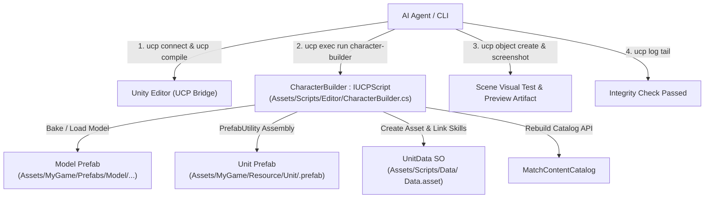

# Workflow Tạo & Tích Hợp Character Tự Động Bằng UCP Unity

Tài liệu quy định quy trình tự động hóa hoàn toàn (Headless / Agentic Automation) thông qua **UCP (Unity Control Protocol)** để thiết kế, lắp ráp và tích hợp một Character mới vào hệ thống Turn-based gameplay dựa trên tài liệu thiết kế:
- [Characters_Overview.md](file:///e:/UnityProject/My%20Turnbased/turnbased_2025/Assets/Docs/Overview/Characters_Overview.md)
- [SKILLS_STATUS_EFFECTS_UNIT_CLASSES_REFERENCE.md](file:///e:/UnityProject/My%20Turnbased/turnbased_2025/Assets/Docs/Overview/SKILLS_STATUS_EFFECTS_UNIT_CLASSES_REFERENCE.md)

---

## 1. Tổng Quan Kiến Trúc & Cơ Chế Điều Khiển UCP

Toàn bộ quy trình từ kiểm tra editor, compile, sinh asset, lắp ráp prefab, wire reference, rebuild catalog đến test/chụp ảnh preview được điều khiển 100% bằng **UCP CLI** và **UCP Bridge (`IUCPScript`)** mà không cần thao tác chuột hay can thiệp Editor UI.



---

## 2. Bảng Định Hướng Visual & Cấu Hình Cho 10 Classes

Căn cứ vào vai trò chiến thuật, bộ kỹ năng và cơ chế VFX của từng class:

| Class | Vai trò & Đặc điểm kỹ năng | Body Sliders (Type / Size / Muscle) | Bộ phận tiêu biểu (Parts) | Tông màu chủ đạo | Vũ khí & Socket (`Weapons/`) |
|---|---|---|---|---|---|
| **Berserker** | Bruiser cận chiến, `Blood Hammer`, đốt máu `BloodRage` | Type: -90<br/>Size: +30<br/>Muscle: +80 | Giáp da thô, ngực trần, găng sắt | Đỏ thẫm, nâu da, đen kim loại | Phải: `Weapon_Smasher` (`Item_Hand_R`) |
| **Knight** | Tanker, `Holy Sword Stance`, `StanceGuard` | Type: -60<br/>Size: +20<br/>Muscle: +40 | Giáp tấm toàn thân, mũ giáp kín, áo choàng ngắn | Bạc kim loại, vàng ánh kim, xanh hoàng gia | Phải: `Weapon_Knight`<br/>Trái: `Shield_Knight` |
| **Magician** | Ranged AoE, `Fireball`, `Fire Seal` | Type: 0<br/>Size: -30<br/>Muscle: -20 | Áo choàng pháp sư, mũ chóp hoặc trùm đầu | Đỏ cam lửa, vàng rực, đen than | Phải: `Weapon_Magician` (`Item_Hand_R`) |
| **Smasher** | Phá đội hình, đẩy lùi (`Earthquake`), gây choáng | Type: -100<br/>Size: +70<br/>Muscle: +100 | Thân hình hộ pháp, giáp vai nặng, đai lưng to | Xám đá, nâu đất, đồng thau | Phải: `Weapon_Smasher1` (`Item_Hand_R`) |
| **Halberdier** | Melee tầm xa 2 ô, lướt `Crescent Slash`, cấm hồi máu | Type: -40<br/>Size: +10<br/>Muscle: +30 | Giáp xích kết hợp giáp tấm nhẹ, mũ lính canh | Thép xanh, trắng bạc, vải viền xanh | Phải: `Spear_Medium` (`Item_Hand_R`) |
| **Assassin** | Cơ động, áp sát nhanh, `Shadow Dual Strike`, gây `Bleed` | Type: -20<br/>Size: -30<br/>Muscle: +20 | Quần áo da bó sát, khăn che mặt, mũ trùm | Đen bóng đêm, tím thẫm, xám tro | Phải: `Weapon_Assassin_R`<br/>Trái: `Weapon_Assassin_L` |
| **Archer** | Bắn tỉa tầm xa, `Multi Strike Arrow`, gây `Freeze` | Type: 0<br/>Size: -15<br/>Muscle: +10 | Áo da nhẹ, bao tay bắn cung, ống tên lưng | Xanh lá rừng, nâu da thuộc, xanh băng | Trái: `Weapon_Archer` (`Item_Hand_L`) |
| **Militia** | Bộ binh giá rẻ, `Power Strike` phá giáp, tự `Bandage` | Type: -30<br/>Size: 0<br/>Muscle: +10 | Quần áo vải thô, giáp ngực đơn sơ, mũ nồi sắt | Nâu đất mộc, xám vải lanh, da thô | Phải: `Weapon_soldier` (`Item_Hand_R`) |
| **Herbalist** | Hồi máu (`Field Remedy`), giải debuff, khiên (`Purification`) | Type: +20<br/>Size: -20<br/>Muscle: -30 | Áo vải choàng nhẹ, túi da đeo hông chứa thảo dược | Xanh lá thảo mộc, nâu gỗ, trắng ngà | Phải: `Weapon_Herbalist` (`Item_Hand_R`) |
| **Adjudicator** | Phán quan, debuff diện rộng, `Verdict Stroke` | Type: -10<br/>Size: +15<br/>Muscle: +15 | Áo choàng tư tế uy nghi, cổ áo đứng, vương miện | Đen huyền bí, viền vàng kim, đỏ ruby | Phải: `Weapon_Adjudicator` (`Item_Hand_R`) |

---

## 3. Kịch Bản Tự Động Hóa UCP (`IUCPScript`)

Để thực thi an toàn trên Main Thread của Unity Editor, tạo script `CharacterBuilder.cs` tại `Assets/Scripts/Editor/CharacterBuilder.cs`:

```csharp
#if UNITY_EDITOR
using System;
using System.IO;
using UCP.Bridge;
using UnityEditor;
using UnityEngine;

public class CharacterBuilder : IUCPScript
{
    public string Name => "character-builder";
    public string Description => "Automated Unit Prefab assembly, UnitData SO setup, and catalog rebuild.";

    [Serializable]
    public class BuildParams
    {
        public string action = "build"; // "build" hoặc "validate"
        public string className;
        public string modelPrefabPath;
        public int health;
        public int baseDamage;
        public int spawnCost;
        public int moveRange;
        public string weaponRightPath;
        public string weaponLeftPath;
        public string[] skillPaths;
        public string animatorControllerPath;
    }

    public object Execute(string paramsJson)
    {
        BuildParams p = JsonUtility.FromJson<BuildParams>(paramsJson);
        if (p == null || string.IsNullOrEmpty(p.className))
            throw new ArgumentException("Invalid parameters: className is required.");

        if (p.action == "validate")
        {
            return ValidateUnit(p.className);
        }

        string unitPrefabPath = $"Assets/MyGame/Resource/Unit/{p.className}.prefab";
        string templatePrefabPath = "Assets/MyGame/Resource/Unit/Knight.prefab";

        if (!File.Exists(unitPrefabPath))
        {
            AssetDatabase.CopyAsset(templatePrefabPath, unitPrefabPath);
            AssetDatabase.ImportAsset(unitPrefabPath);
        }

        GameObject root = PrefabUtility.LoadPrefabContents(unitPrefabPath);
        try
        {
            Transform body = root.transform.Find("Body");
            if (body == null) throw new InvalidOperationException("Prefab missing 'Body' child node.");
            body.localScale = new Vector3(1.5f, 1.5f, 1.5f);

            // 1. Gắn Model Prefab vào Body
            if (!string.IsNullOrEmpty(p.modelPrefabPath))
            {
                for (int i = body.childCount - 1; i >= 0; i--)
                {
                    Transform child = body.GetChild(i);
                    if (!child.name.Contains("Socket") && !child.name.Contains("EffectSpawnPoint"))
                    {
                        UnityEngine.Object.DestroyImmediate(child.gameObject);
                    }
                }

                GameObject modelPrefab = AssetDatabase.LoadAssetAtPath<GameObject>(p.modelPrefabPath);
                if (modelPrefab != null)
                {
                    GameObject modelInst = (GameObject)PrefabUtility.InstantiatePrefab(modelPrefab, body);
                    modelInst.transform.localPosition = Vector3.zero;
                    modelInst.transform.localRotation = Quaternion.identity;
                    modelInst.transform.localScale = Vector3.one;
                }
            }

            // 2. Cấu hình Animator
            Animator animator = body.GetComponent<Animator>();
            if (animator != null && !string.IsNullOrEmpty(p.animatorControllerPath))
            {
                animator.runtimeAnimatorController = AssetDatabase.LoadAssetAtPath<RuntimeAnimatorController>(p.animatorControllerPath);
                animator.applyRootMotion = false;
            }

            // 3. Gắn Socket Vũ khí
            AttachWeapon(body, "Item_Hand_R", p.weaponRightPath);
            AttachWeapon(body, "Item_Hand_L", p.weaponLeftPath);

            // 4. Cấu hình UnitData ScriptableObject
            string dataPath = $"Assets/Scripts/Data/{p.className} Data.asset";
            UnitData data = AssetDatabase.LoadAssetAtPath<UnitData>(dataPath);
            if (data == null)
            {
                data = ScriptableObject.CreateInstance<UnitData>();
                AssetDatabase.CreateAsset(data, dataPath);
            }

            data.unitName = p.className;
            data.Health = p.health;
            data.BaseDamage = p.baseDamage;
            data.spawnCost = p.spawnCost;
            data.moveRange = p.moveRange;

            if (p.skillPaths != null && p.skillPaths.Length > 0)
            {
                data.startingSkills = new SkillBase[p.skillPaths.Length];
                for (int i = 0; i < p.skillPaths.Length; i++)
                {
                    data.startingSkills[i] = AssetDatabase.LoadAssetAtPath<SkillBase>(p.skillPaths[i]);
                }
            }
            EditorUtility.SetDirty(data);

            // 5. Gán UnitData vào UnitController
            UnitController controller = root.GetComponent<UnitController>();
            if (controller != null)
            {
                controller.unitData = data;
                controller.RotationNode = body;
            }

            PrefabUtility.SaveAsPrefabAsset(root, unitPrefabPath);
        }
        finally
        {
            PrefabUtility.UnloadPrefabContents(root);
            AssetDatabase.SaveAssets();
            AssetDatabase.Refresh();
        }

        // 6. Rebuild Catalog
        EditorApplication.ExecuteMenuItem("Tools/Multiplayer/Rebuild Content Catalog");

        return new { success = true, className = p.className, prefab = unitPrefabPath };
    }

    private void AttachWeapon(Transform parent, string socketName, string weaponPath)
    {
        if (string.IsNullOrEmpty(weaponPath)) return;
        Transform socket = FindDeepChild(parent, socketName);
        if (socket == null) return;

        for (int i = socket.childCount - 1; i >= 0; i--)
        {
            UnityEngine.Object.DestroyImmediate(socket.GetChild(i).gameObject);
        }

        GameObject weaponPrefab = AssetDatabase.LoadAssetAtPath<GameObject>(weaponPath);
        if (weaponPrefab != null)
        {
            GameObject inst = (GameObject)PrefabUtility.InstantiatePrefab(weaponPrefab, socket);
            inst.transform.localPosition = Vector3.zero;
            inst.transform.localRotation = Quaternion.identity;
            inst.transform.localScale = Vector3.one;
        }
    }

    private Transform FindDeepChild(Transform parent, string name)
    {
        foreach (Transform child in parent)
        {
            if (child.name == name) return child;
            Transform res = FindDeepChild(child, name);
            if (res != null) return res;
        }
        return null;
    }

    private object ValidateUnit(string className)
    {
        string prefabPath = $"Assets/MyGame/Resource/Unit/{className}.prefab";
        GameObject prefab = AssetDatabase.LoadAssetAtPath<GameObject>(prefabPath);
        if (prefab == null) return new { valid = false, error = "Prefab not found" };

        UnitController controller = prefab.GetComponent<UnitController>();
        if (controller == null) return new { valid = false, error = "Missing UnitController" };
        if (controller.unitData == null) return new { valid = false, error = "Missing UnitData reference" };
        if (controller.unitData.startingSkills == null || controller.unitData.startingSkills.Length != 3)
            return new { valid = false, error = "Starting skills count must be exactly 3" };

        return new { valid = true, className = className, prefab = prefabPath };
    }
}
#endif
```

---

## 4. Quy Trình Thực Thi Bằng Lệnh UCP (Từng Bước)

### Bước 1: Kiểm Tra Trạng Thái & Biên Dịch
```powershell
# 1. Kiểm tra kết nối tới Unity Bridge
ucp connect

# 2. Kiểm tra Editor đang ở Edit Mode (scene HUDScene hoặc scene làm việc)
ucp editor status

# 3. Kích hoạt recompile và xác nhận không có lỗi cú pháp
ucp compile --json
```

### Bước 2: Kiểm Tra Danh Sách UCP Scripts
```powershell
# Xác nhận CharacterBuilder đã được phát hiện bởi UCP Bridge
ucp exec list
```

### Bước 3: Thực Thi Dựng Character Qua UCP Script
Ví dụ tạo nhân vật **Herbalist**:
```powershell
ucp exec run character-builder --params '{
  "action": "build",
  "className": "Herbalist",
  "modelPrefabPath": "Assets/MyGame/Prefabs/Model/Herbalist_M/Herbalist/Herbalist.prefab",
  "health": 80,
  "baseDamage": 12,
  "spawnCost": 3,
  "moveRange": 3,
  "weaponRightPath": "Assets/MyGame/Resource/Unit/Weapons/Weapon_Herbalist.prefab",
  "weaponLeftPath": "",
  "skillPaths": [
    "Assets/Scripts/Data/SkillData/Herbalist/FieldRemedy.asset",
    "Assets/Scripts/Data/SkillData/Herbalist/Purification.asset",
    "Assets/Scripts/Data/SkillData/Herbalist/HerbalBlessing.asset"
  ],
  "animatorControllerPath": "Assets/MyGame/Animations/Herbalist/Herbalist.controller"
}' --json
```

### Bước 4: Kiểm Chứng Tự Động (Integrity Validation)
```powershell
# Chạy validate logic prefab và data
ucp exec run character-builder --params '{"action":"validate","className":"Herbalist"}' --json

# Kiểm tra log Console để đảm bảo không có cảnh báo/lỗi missing scripts
ucp log tail --lines 20
```

### Bước 5: Spawn Thử Nghiệm & Chụp Ảnh Bằng UCP CLI
```powershell
# 1. Tạo instance thử nghiệm trong Scene đang mở
ucp object create --prefab "Assets/MyGame/Resource/Unit/Herbalist.prefab" --json

# 2. Chụp ảnh màn hình kiểm tra visual
ucp screenshot --output "Artifacts/Herbalist_Preview.png"

# 3. Lấy snapshot để xóa instance test sau khi kiểm tra xong
ucp scene snapshot --json
ucp object delete <instance_id>
```
