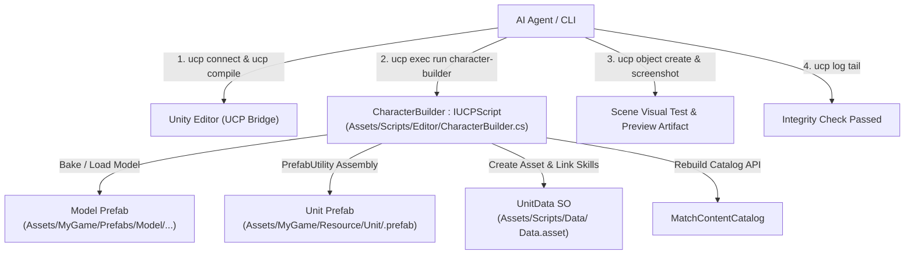

# Workflow Tạo & Tích Hợp Character Tự Động Bằng UCP Unity

Tài liệu quy định quy trình tự động hóa hoàn toàn (Headless / Agentic Automation) thông qua **UCP (Unity Control Protocol)** để thiết kế, lắp ráp và tích hợp một Character mới vào hệ thống Turn-based gameplay dựa trên tài liệu thiết kế:
- [Characters_Overview.md](file:///e:/UnityProject/My%20Turnbased/turnbased_2025/Assets/Docs/Overview/Characters_Overview.md)
- [SKILLS_STATUS_EFFECTS_UNIT_CLASSES_REFERENCE.md](file:///e:/UnityProject/My%20Turnbased/turnbased_2025/Assets/Docs/Overview/SKILLS_STATUS_EFFECTS_UNIT_CLASSES_REFERENCE.md)

---

## 1. Tổng Quan Kiến Trúc & Cơ Chế Điều Khiển UCP

Toàn bộ quy trình từ kiểm tra editor, compile, sinh asset, lắp ráp prefab, wire reference, rebuild catalog đến test/chụp ảnh preview được điều khiển 100% bằng **UCP CLI** và **UCP Bridge (`IUCPScript`)** mà không cần thao tác chuột hay can thiệp Editor UI.



---

## 2. Bảng Định Hướng Visual & Cấu Hình Cho 10 Classes

Căn cứ vào vai trò chiến thuật, bộ kỹ năng và cơ chế VFX của từng class:

| Class | Vai trò & Đặc điểm kỹ năng | Body Sliders (Type / Size / Muscle) | Bộ phận tiêu biểu (Parts) | Tông màu chủ đạo | Vũ khí & Socket (`Weapons/`) |
|---|---|---|---|---|---|
| **Berserker** | Bruiser cận chiến, `Blood Hammer`, đốt máu `BloodRage` | Type: -90<br/>Size: +30<br/>Muscle: +80 | Giáp da thô, ngực trần, găng sắt | Đỏ thẫm, nâu da, đen kim loại | Phải: `Weapon_Smasher` (`Item_Hand_R`) |
| **Knight** | Tanker, `Holy Sword Stance`, `StanceGuard` | Type: -60<br/>Size: +20<br/>Muscle: +40 | Giáp tấm toàn thân, mũ giáp kín, áo choàng ngắn | Bạc kim loại, vàng ánh kim, xanh hoàng gia | Phải: `Weapon_Knight`<br/>Trái: `Shield_Knight` |
| **Magician** | Ranged AoE, `Fireball`, `Fire Seal` | Type: 0<br/>Size: -30<br/>Muscle: -20 | Áo choàng pháp sư, mũ chóp hoặc trùm đầu | Đỏ cam lửa, vàng rực, đen than | Phải: `Weapon_Magician` (`Item_Hand_R`) |
| **Smasher** | Phá đội hình, đẩy lùi (`Earthquake`), gây choáng | Type: -100<br/>Size: +70<br/>Muscle: +100 | Thân hình hộ pháp, giáp vai nặng, đai lưng to | Xám đá, nâu đất, đồng thau | Phải: `Weapon_Smasher1` (`Item_Hand_R`) |
| **Halberdier** | Melee tầm xa 2 ô, lướt `Crescent Slash`, cấm hồi máu | Type: -40<br/>Size: +10<br/>Muscle: +30 | Giáp xích kết hợp giáp tấm nhẹ, mũ lính canh | Thép xanh, trắng bạc, vải viền xanh | Phải: `Spear_Medium` (`Item_Hand_R`) |
| **Assassin** | Cơ động, áp sát nhanh, `Shadow Dual Strike`, gây `Bleed` | Type: -20<br/>Size: -30<br/>Muscle: +20 | Quần áo da bó sát, khăn che mặt, mũ trùm | Đen bóng đêm, tím thẫm, xám tro | Phải: `Weapon_Assassin_R`<br/>Trái: `Weapon_Assassin_L` |
| **Archer** | Bắn tỉa tầm xa, `Multi Strike Arrow`, gây `Freeze` | Type: 0<br/>Size: -15<br/>Muscle: +10 | Áo da nhẹ, bao tay bắn cung, ống tên lưng | Xanh lá rừng, nâu da thuộc, xanh băng | Trái: `Weapon_Archer` (`Item_Hand_L`) |
| **Militia** | Bộ binh giá rẻ, `Power Strike` phá giáp, tự `Bandage` | Type: -30<br/>Size: 0<br/>Muscle: +10 | Quần áo vải thô, giáp ngực đơn sơ, mũ nồi sắt | Nâu đất mộc, xám vải lanh, da thô | Phải: `Weapon_Militia` (`Item_Hand_R`) |
| **Herbalist** | Hồi máu (`Field Remedy`), giải debuff, khiên (`Purification`) | Type: +20<br/>Size: -20<br/>Muscle: -30 | Áo vải choàng nhẹ, túi da đeo hông chứa thảo dược | Xanh lá thảo mộc, nâu gỗ, trắng ngà | Phải: `Weapon_Herbalist` (`Item_Hand_R`) |
| **Adjudicator** | Phán quan, debuff diện rộng, `Verdict Stroke` | Type: -10<br/>Size: +15<br/>Muscle: +15 | Áo choàng tư tế uy nghi, cổ áo đứng, vương miện | Đen huyền bí, viền vàng kim, đỏ ruby | Phải: `Weapon_Adjudicator` (`prop_r`, pos: `(-0.014, -0.15, -0.033)`, rot: `(180, 0, 0)`) |

---

## 3. Kịch Bản Tự Động Hóa UCP (`IUCPScript`)

Script tự động hóa được triển khai tại [`Assets/Scripts/Editor/CharacterBuilder.cs`](file:///e:/UnityProject/My%20Turnbased/turnbased_2025/Assets/Scripts/Editor/CharacterBuilder.cs), kế thừa `IUCPScript` (`UCP.Bridge`) để chạy trực tiếp trên Main Thread của Unity Editor thông qua UCP CLI.

### Bảng Tham Số Cấu Hình (`BuildParams`)

| Nhóm | Tham số | Kiểu dữ liệu | Mặc định | Mô tả |
|---|---|---|---|---|
| **Chung** | `action` | `string` | `"build"` | `"build"` (lắp ráp/tạo unit) hoặc `"validate"` (kiểm tra toàn vẹn) |
| | `className` | `string` | *(Bắt buộc)* | Tên class (ví dụ: `Berserker`, `Adjudicator`, `Herbalist`) |
| | `outputPrefabPath` | `string` | `Assets/MyGame/Resource/Unit/<className>.prefab` | Đường dẫn lưu Unit Prefab hoàn chỉnh |
| | `baseUnitPrefabPath` | `string` | `Assets/MyGame/Resource/Unit/Knight.prefab` | Template prefab chuẩn chứa `Body`, `UnitController`, `UnitAnimator` |
| **Synty Sidekick** | `generateSidekickModel` | `bool` | `false` | `true`: tự động query DB, combine mesh, bake texture và tạo Humanoid Avatar |
| | `bodyTypeBlend` | `float` | `-10` | Hình thể (-100: vạm vỡ/nam tính, +100: mảnh mai/nữ tính) |
| | `bodySizeBlend` | `float` | `15` | Độ to béo / gầy |
| | `musclesBlend` | `float` | `15` | Độ cơ bắp |
| | `partNames` | `string[]` | *Bộ Adjudicator* | Danh sách tên mesh part (`SidekickPart`) ghép vào nhân vật |
| | `palette` | `ColorPaletteParams`| `null` | Nhóm màu: `skinColor`, `hairColor`, `eyeColor`, `primaryColor`, `secondaryColor`, `trimColor`, `metalColor`, `jewelColor` |
| | `primaryColor`, ... | `string` | *(Mặc định)* | Các trường mã hex màu flat tương đương (thuận tiện khi truyền CLI) |
| | `colorOverrides` | `ColorOverride[]` | `null` | Mảng ghi đè màu trực tiếp theo từ khóa tên thuộc tính |
| | `modelPrefabPath` | `string` | `Assets/MyGame/Prefabs/Model/<className>_M/<className>.prefab` | Đường dẫn Model Prefab (sử dụng khi `generateSidekickModel = false`) |
| **Vũ khí** | `weaponPrefabPath` | `string` | `""` | Đường dẫn prefab vũ khí gắn vào socket |
| | `weaponBoneName` | `string` | `"prop_r"` | Tên bone gắn vũ khí (tự động fallback `prop_r` -> `hand_r` -> `ring_01_r`) |
| | `weaponLocalPos` | `Vector3` | `(0.033, 0.016, 0.002)` | Vị trí offset local |
| | `weaponLocalEuler` | `Vector3` | `(-2.5, -94, 88)` | Góc xoay offset local |
| | `weaponLocalScale` | `Vector3` | `(1, 1, 1)` | Tỉ lệ phóng to/thu nhỏ |
| **Gameplay Data** | `unitDataPath` | `string` | `""` | Đường dẫn ScriptableObject `UnitData` |
| | `skillPaths` | `string[]` | `[]` | Danh sách asset `SkillBase` nạp vào `StartingSkills` của UnitData |
| | `animatorControllerPath` | `string` | `""` | Đường dẫn `RuntimeAnimatorController` gắn vào Animator trên `Body` |

---

## 4. Quy Trình Thực Thi Bằng Lệnh UCP (Từng Bước)

### Bước 1: Kiểm Tra Trạng Thái & Biên Dịch
```powershell
# 1. Kiểm tra kết nối tới Unity Bridge
ucp connect

# 2. Kiểm tra Editor đang ở Edit Mode (scene HUDScene hoặc scene làm việc)
ucp editor status

# 3. Kích hoạt recompile và xác nhận không có lỗi cú pháp
ucp compile --json
```

### Bước 2: Kiểm Tra Danh Sách UCP Scripts
```powershell
# Xác nhận character-builder đã được phát hiện bởi UCP Bridge
ucp exec list
```

### Bước 3: Thực Thi Dựng Character Qua UCP Script

#### Kịch bản A: Tự động sinh Model Sidekick + Lắp ráp Unit Prefab (Ví dụ: Berserker)
```powershell
ucp exec run character-builder --params '{
  "action": "build",
  "className": "Berserker",
  "generateSidekickModel": true,
  "bodyTypeBlend": -90,
  "bodySizeBlend": 30,
  "musclesBlend": 80,
  "primaryColor": "8B0000",
  "secondaryColor": "4A2E18",
  "trimColor": "1F1F1F",
  "metalColor": "4B4B4B",
  "partNames": [
    "SK_HUMN_BASE_02_01HEAD_HU01",
    "SK_HUMN_BASE_03_03EBRL_HU01",
    "SK_HUMN_BASE_03_04EBRR_HU01",
    "SK_HUMN_BASE_01_05EYEL_HU01",
    "SK_HUMN_BASE_01_06EYER_HU01",
    "SK_HUMN_BASE_01_07EARL_HU01",
    "SK_HUMN_BASE_01_08EARR_HU01",
    "SK_HUMN_BASE_02_35NOSE_HU01",
    "SK_HUMN_BASE_01_36TETH_HU01",
    "SK_HUMN_BASE_01_37TONG_HU01",
    "SK_FANT_WARR_01_10TORS_HU01",
    "SK_FANT_WARR_01_17HIPS_HU01",
    "SK_FANT_WARR_01_18LEGL_HU01",
    "SK_FANT_WARR_01_19LEGR_HU01",
    "SK_FANT_WARR_01_20FOTL_HU01",
    "SK_FANT_WARR_01_21FOTR_HU01"
  ],
  "weaponPrefabPath": "Assets/MyGame/Resource/Weapon/Weapon_Smasher.prefab",
  "unitDataPath": "Assets/Scripts/Data/Berserker Data.asset",
  "animatorControllerPath": "Assets/MyGame/Animations/BerserkerController.controller"
}' --json
```

#### Kịch bản B: Dùng Model Prefab có sẵn từ Sidekick Editor (Ví dụ: Herbalist)
```powershell
ucp exec run character-builder --params '{
  "action": "build",
  "className": "Herbalist",
  "generateSidekickModel": false,
  "modelPrefabPath": "Assets/MyGame/Prefabs/Model/Herbalist_M/Herbalist.prefab",
  "weaponPrefabPath": "Assets/MyGame/Resource/Unit/Weapons/Weapon_Herbalist.prefab",
  "weaponBoneName": "prop_r",
  "unitDataPath": "Assets/Scripts/Data/Herbalist Data.asset",
  "skillPaths": [
    "Assets/Scripts/Data/SkillData/Herbalist/FieldRemedy.asset",
    "Assets/Scripts/Data/SkillData/Herbalist/Purification.asset",
    "Assets/Scripts/Data/SkillData/Herbalist/HerbalBlessing.asset"
  ],
  "animatorControllerPath": "Assets/MyGame/Animations/Herbalist/Herbalist.controller"
}' --json
```

### Bước 4: Kiểm Chứng Tự Động (Integrity Validation)
```powershell
# Chạy validate cấu trúc Prefab, Body scale 1.5, Avatar, Controller, UnitData và StartingSkills
ucp exec run character-builder --params "{\"action\":\"validate\",\"className\":\"Berserker\"}" --json

# Kiểm tra log Console để đảm bảo không có cảnh báo/lỗi missing scripts
ucp log tail --lines 20
```

### Bước 5: Spawn Thử Nghiệm & Chụp Ảnh Bằng UCP CLI
```powershell
# 1. Tạo instance thử nghiệm trong Scene đang mở
ucp object create --prefab "Assets/MyGame/Resource/Unit/Herbalist.prefab" --json

# 2. Chụp ảnh màn hình kiểm tra visual
ucp screenshot --output "Artifacts/Herbalist_Preview.png"

# 3. Lấy snapshot để xóa instance test sau khi kiểm tra xong
ucp scene snapshot --json
ucp object delete <instance_id>
```
